<p align="center">
  <a href="README.md">English</a> ·
  <a href="README.ru.md">Русский</a> ·
  <b>Español</b> ·
  <a href="README.pt.md">Português</a> ·
  <a href="README.de.md">Deutsch</a> ·
  <a href="README.fr.md">Français</a> ·
  <a href="README.zh.md">中文</a> ·
  <a href="README.ja.md">日本語</a> ·
  <a href="README.ko.md">한국어</a>
</p>

<p align="center">
  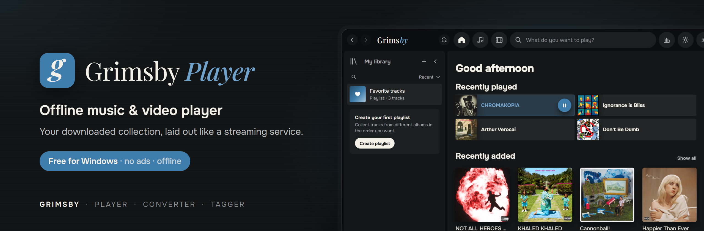
</p>

<p align="center">
  <b>El álbum entero. Y todo lo que lo rodea.</b><br>
  Videoclips, películas de álbum y conciertos junto a cada álbum, todo desde tu propia biblioteca.
</p>

<p align="center">
  <a href="https://github.com/maksimkhatskevich/grimsby-releases/releases/latest"></a>
  
  
  <a href="https://www.virustotal.com/gui/file/cd84cb09879b227d1e1acb80da62985b515666c8056d0c93bc0018b9bdd5bb0b"></a>
  <a href="https://github.com/maksimkhatskevich/grimsby-releases/releases"></a>
</p>

<p align="center">
  <a href="https://github.com/maksimkhatskevich/grimsby-releases/releases/latest"><b>⬇ Descargar para Windows</b></a>
</p>

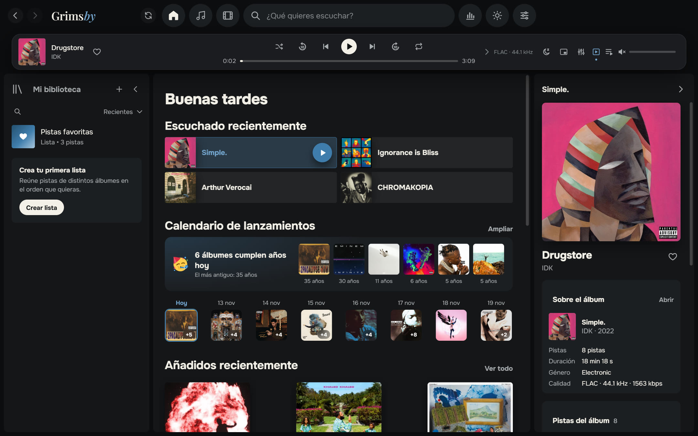

---

## Álbumes, tal como los concibieron sus artistas

Para Grimsby un álbum es una obra completa, no un montón de pistas. Un video dentro de la carpeta de un álbum se convierte en su videoclip; las películas de álbum y los conciertos están junto a la música.

Si descargas álbumes en FLAC, coleccionas discografías y guardas videoclips y conciertos, conoces el problema.
Los servicios de streaming lucen genial, pero tu música no está ahí: lanzamientos raros, rips de calidad, videos que desaparecieron de internet.
Los reproductores clásicos manejan bien tus archivos, pero su interfaz parece de 2008.

**Grimsby une ambos mundos.** Indícale tu carpeta de música y en un minuto tu colección se convierte en una biblioteca preciosa:
álbumes por año, páginas de artistas con fotos, videoclips junto a los álbumes, estadísticas y un resumen del año.
Sin cuentas, sin suscripciones, sin anuncios y sin internet.

| | Streaming | Reproductor clásico | **Grimsby** |
|---|:---:|:---:|:---:|
| Tus propios archivos (FLAC, lanzamientos raros) | ✕ | ✓ | **✓** |
| Interfaz moderna y bonita | ✓ | ✕ | **✓** |
| Videoclips, conciertos y películas junto a los álbumes | en parte | ✕ | **✓** |
| Estadísticas y resumen del año | ✓ | ✕ | **✓** |
| Conversor, buscador de duplicados, editor de etiquetas | ✕ | en parte | **✓** |
| Funciona sin internet ni suscripción | ✕ | ✓ | **✓** |
| No envía nada sobre ti a ningún sitio | ✕ | ✓ | **✓** |

**¿No te interesan los álbumes?** Cambia la biblioteca a **Solo pistas** en Ajustes: Grimsby se convierte en un reproductor sencillo de pistas, sin páginas de álbum.

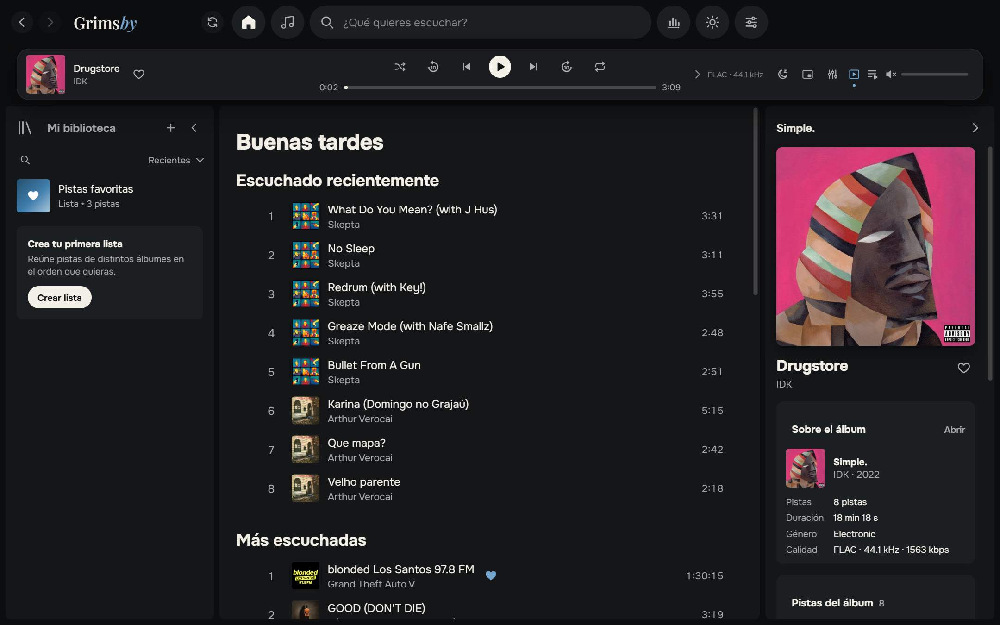

---

## Funciones

### 💿 Los álbumes, primero

Grimsby está pensado para escuchar álbumes completos. Toda tu colección se ordena por año de lanzamiento: una franja de años arriba,
el encabezado del año actual queda fijo en la parte superior y, al hacer clic, abre un calendario para saltar rápido.
También hay pestañas «Todas las pistas» (ordenables por columna), «Artistas», «Por título», «Por artista» y «Añadidos recientemente», además de una franja alfabética.

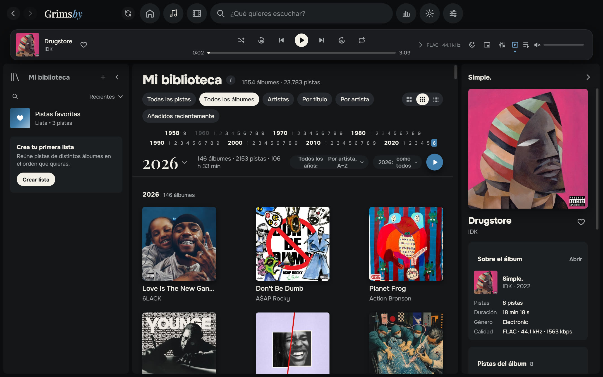

- **Instantáneo incluso con bibliotecas enormes.** Probado con 23 783 pistas y 1554 álbumes (286 GB): desplazamiento fluido y búsqueda inmediata.
- **Escanea solo cuando tú quieras:** en cada inicio, una vez al día o manualmente. Los archivos ya conocidos no se vuelven a leer.
- **MP3, FLAC, ALAC, AAC/M4A, OGG, Opus y WAV.** Grimsby convierte por su cuenta el Apple Lossless que los motores de navegador no reproducen.
- **Álbumes de varios discos** divididos en «Disco 1», «Disco 2»… con numeración dentro de cada disco.
- **Artistas invitados** detectados en los títulos — `(feat. …)`, `(ft. …)`, `(with …)` — que también aparecen en sus páginas.
- **Tamaño de portadas**: grandes, normales o pequeñas, por separado para música y vídeos.

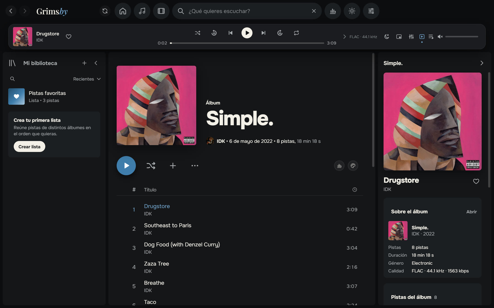

### 🎤 Toda la historia de un artista en una página

Álbumes, sencillos, videoclips, películas, conciertos y colaboraciones en una sola página. Grimsby descarga las fotos de artistas una sola vez; después todo funciona offline.
Ahí mismo tienes la radio del artista y «Ver todos los videos».

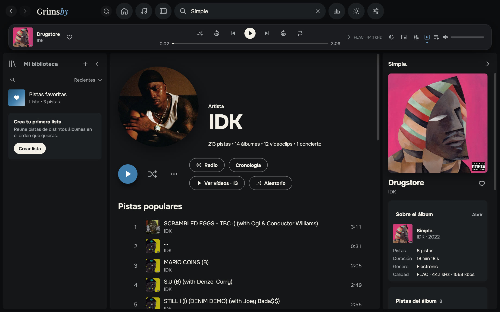

### 📈 Cronología de álbumes

Todos los álbumes de un artista en una línea de tiempo con marcas por año: cuánto pasó entre lanzamientos, la pausa más larga y cuántos días han pasado desde el último álbum. Haz clic en dos álbumes cualesquiera para ver el tiempo entre ellos. Se abre con el botón **Cronología** en la página del artista o desde el calendario de lanzamientos completo.

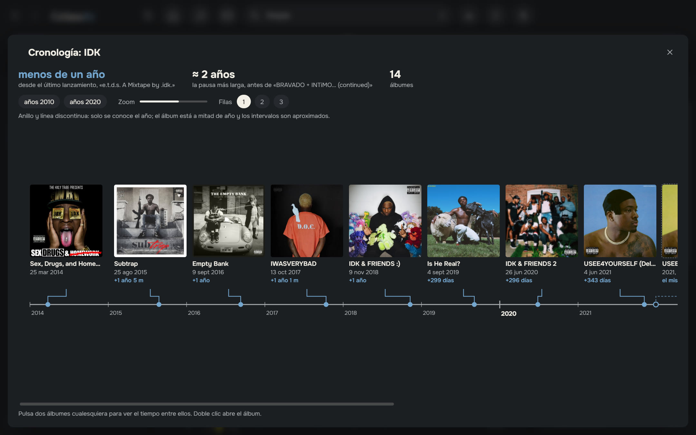

### 🔎 Búsqueda por género y letras

La búsqueda encuentra no solo títulos y artistas, sino también géneros y versos de las letras, de las etiquetas y de los archivos .lrc junto a la pista. Los resultados muestran dónde está la coincidencia. Las mayúsculas no importan, y si una errata no encuentra nada, Grimsby muestra lo más parecido. Los géneros ahora cuentan por separado: «Pop, Hip-Hop» son dos géneros en las estadísticas, en las páginas de género y en el ecualizador.

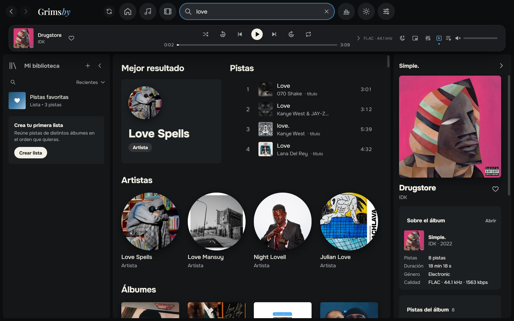

### 🎬 Videoclips, conciertos y películas de álbumes

Algo que no tiene ningún servicio de streaming. Grimsby organiza tu carpeta de videos por sí solo:

- los videos llamados `Artista — Título` se agrupan por artista y año;
- un video dentro de la carpeta de un álbum se convierte en videoclip **de ese álbum**;
- los archivos marcados con `(Film)` se convierten en **películas del álbum**, y el álbum y su película se recomiendan mutuamente;
- la carpeta `concerts` se convierte en una sección de conciertos con series (por ejemplo, *Tiny Desk Concert*).

Los videos se reproducen dentro de la app. Puedes encogerlos a una esquina del reproductor y seguir navegando.
Si un archivo usa un códec raro (por ejemplo, AV1 en 4K), Grimsby prepara una copia compatible él solo.
Si una canción tiene videoclip, en el reproductor aparece el botón **Ver el vídeo**; desde el video, **Escuchar la pista** vuelve a la canción en el mismo momento.

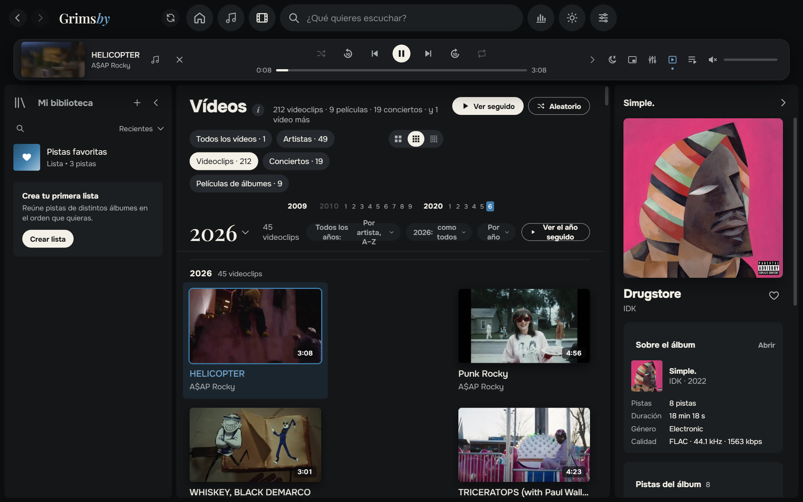

¿No ves videoclips? Desactiva toda la sección con un solo interruptor en los ajustes.

### 🧰 Tu biblioteca, en orden

- **Conversor de archivos**: MP3, AAC (M4A), Opus, OGG, FLAC, ALAC y WAV. Las etiquetas y portadas se conservan. Guarda copias en otra carpeta o sustituye los originales: los archivos antiguos van a la Papelera y tus favoritos y listas pasan a los nuevos. Elige las pistas con casillas.
- **Buscador de duplicados**: la misma pista en archivos distintos y copias de carpetas de álbumes, con la carpeta, el formato y el bitrate de cada copia. ¿No es un duplicado? Pulsa «Todo en orden» y Grimsby lo recordará.
- **Salud de la biblioteca** con carita de ánimo 😊 😐 😟: álbumes sin portada, año o género, pistas sin número, archivos ilegibles, y cómo arreglarlo.
- **Álbumes sin fecha de lanzamiento**: una lista de álbumes sin fecha completa; busca las fechas en internet para todos los seleccionados a la vez o escríbelas a mano, y guárdalas solo en Grimsby o en las etiquetas.
- **Editar detalles**: etiquetas y portada de un álbum entero a la vez, incluida la división en discos. Grimsby hace copia de seguridad antes de cambiar nada.

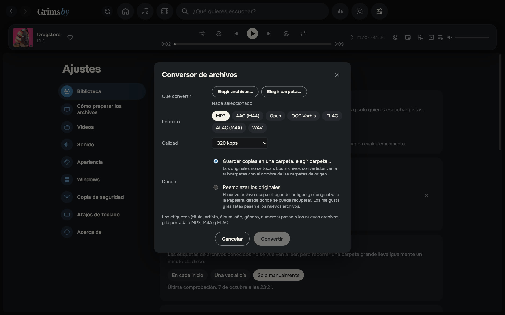

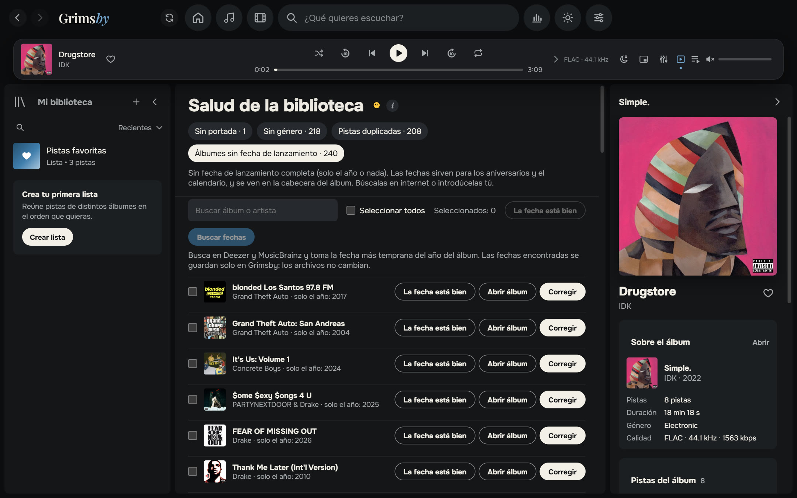

### 🔊 Sonido de reproductor de verdad

- **Reproducción sin pausas (gapless)**: los álbumes conceptuales suenan sin cortes entre pistas.
- **Fundido cruzado de 2 a 12 segundos**, que se desactiva solo dentro de un mismo álbum.
- **Nivelación de volumen (ReplayGain / LUFS)**: inteligente, por pista o por álbum.
- **Ecualizador de 10 bandas** con preajustes: Hip-hop, R&B, Más graves, Voces, Volumen bajo y más.
- **Temporizador de apagado, mini reproductor siempre visible, «Reproducir a continuación» y cola con arrastrar y soltar.**
- **Pistas largas y mezclas** continúan donde las dejaste.

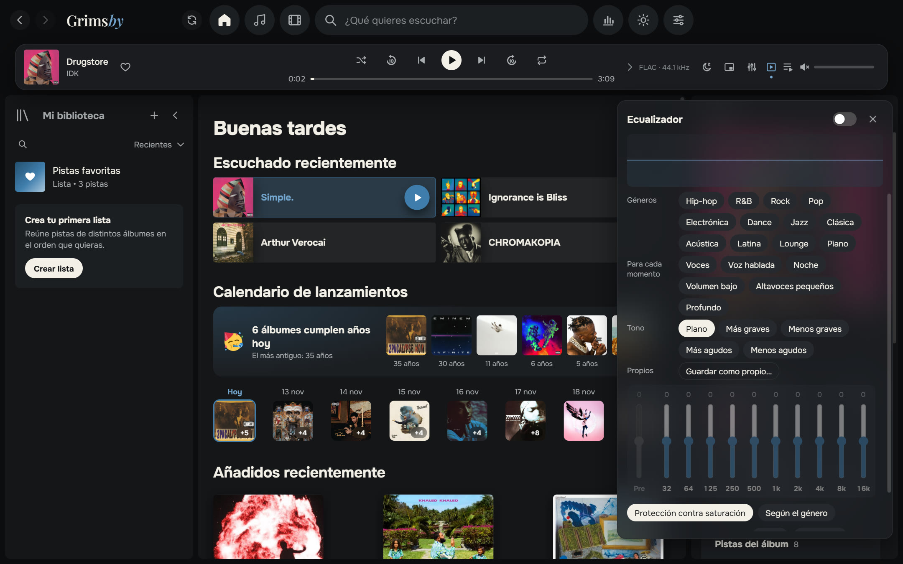

### 📻 Listas que se hacen solas

- **Listas inteligentes**, entre ellas **«Radio: mi mix»** — lo que más escuchas mezclado con música parecida por género y año — y **«Radio del artista»**, un mix en torno a un artista o género.
- **Tu propio orden** de listas y carpetas en el panel lateral, que se mantiene aunque cambies de orden y vuelvas.
- Ordena «Pistas favoritas» y listas por número, artista, título, álbum o duración, desde un menú o pulsando los encabezados de columna.
- Portadas y descripciones propias para las listas.

### 📊 Estadísticas para amantes de los números

**Escuchas** de la semana, el mes, el año y de siempre: top de artistas, álbumes y pistas por minutos o reproducciones, rachas de días con música. Las cifras se actualizan en directo mientras suena la música.
**Colección**: cuántas pistas, álbumes, géneros, gigabytes y horas de música tienes, qué parte es lossless y cuántos álbumes **nunca has escuchado**.
**Estadísticas de álbum**: abre cualquier álbum y mira con qué frecuencia lo escuchas, cuánto de él oyes realmente y qué pistas saltas. Recorre semanas, meses y años anteriores con las flechas.

Oculta un artista o un álbum de los tops desde las estadísticas y recupéralo en **Ocultos**. **Cuánto escuchar** muestra toda la biblioteca, lo que ya sonó, lo que no y cuántos días hacen falta para oírlo todo a 1, 2 o 4 horas al día.

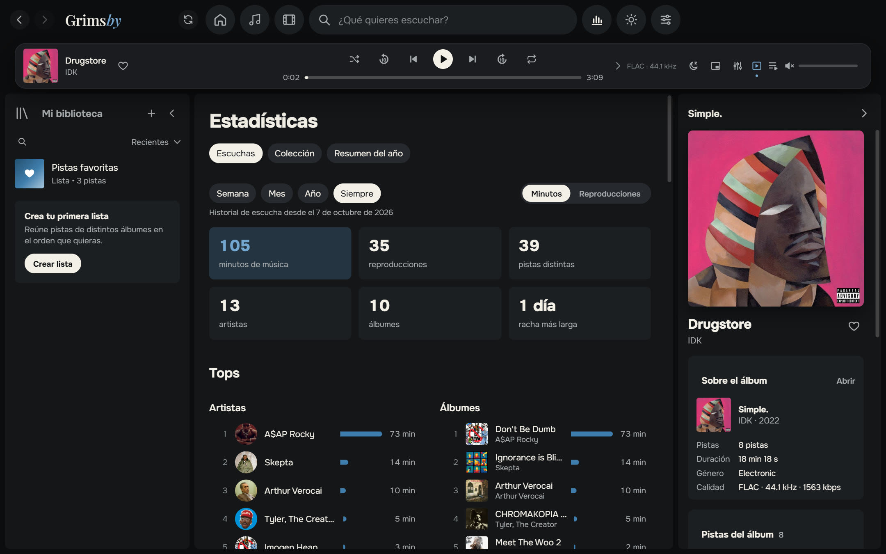

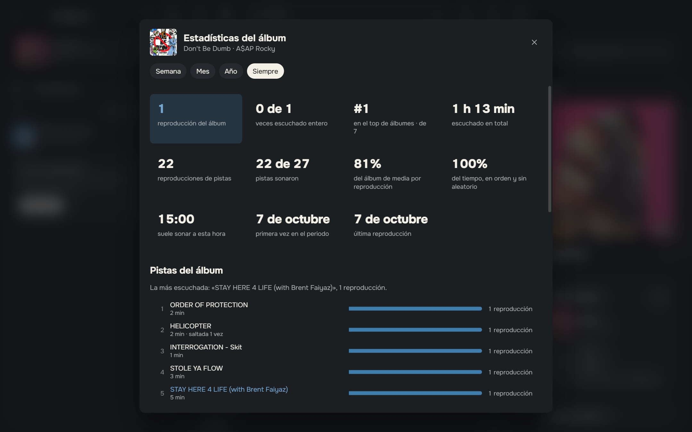

### 🎁 Resumen del año

Del 1 de diciembre al 15 de enero, Grimsby te regala tu resumen del año: artista del año, álbum del año, pistas favoritas, récords, descubrimientos y tu tipo de oyente
(«Fan incondicional», «Explorador», «Noctámbulo», «Maratonista»…). Cada tarjeta se puede guardar como imagen para historias, en tema oscuro o claro.

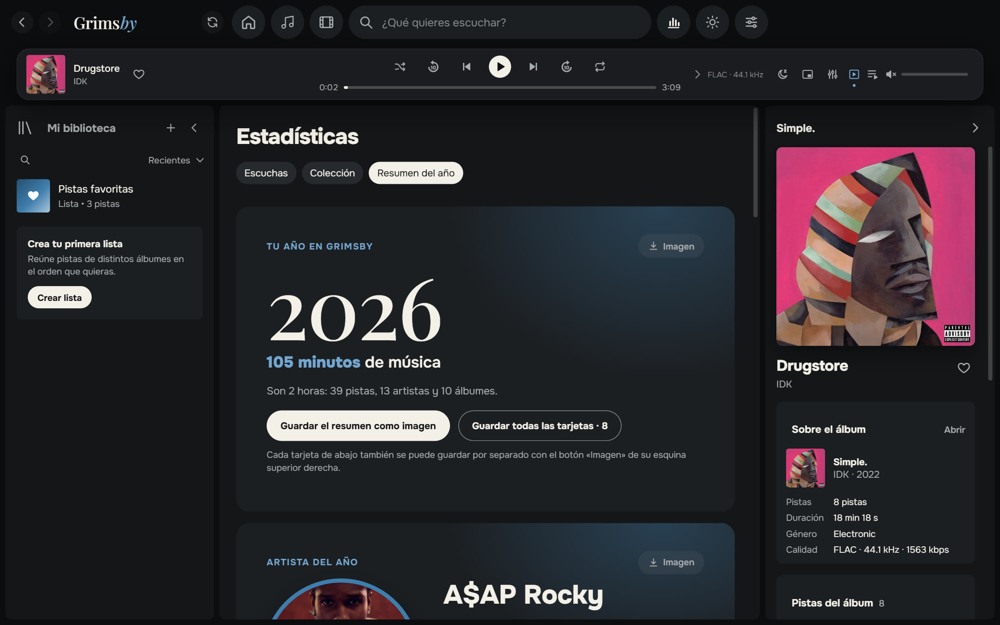

### 🎨 Tema oscuro y claro, colores de la portada

El azul característico de Grimsby, grafito y «papel». Elige un tema o sigue a Windows. La página de un álbum o lista puede tomar los colores de su portada, desde un brillo suave hasta un relleno completo, con un botón de paleta en la propia página.

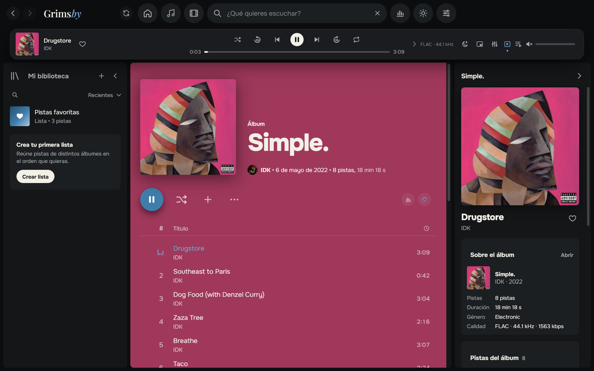

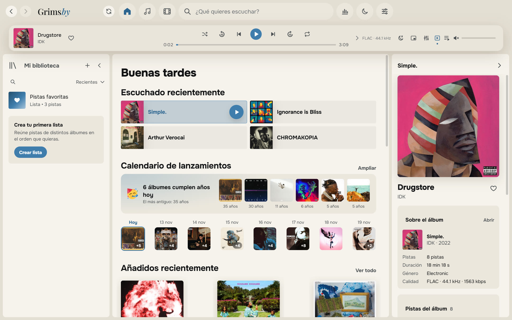

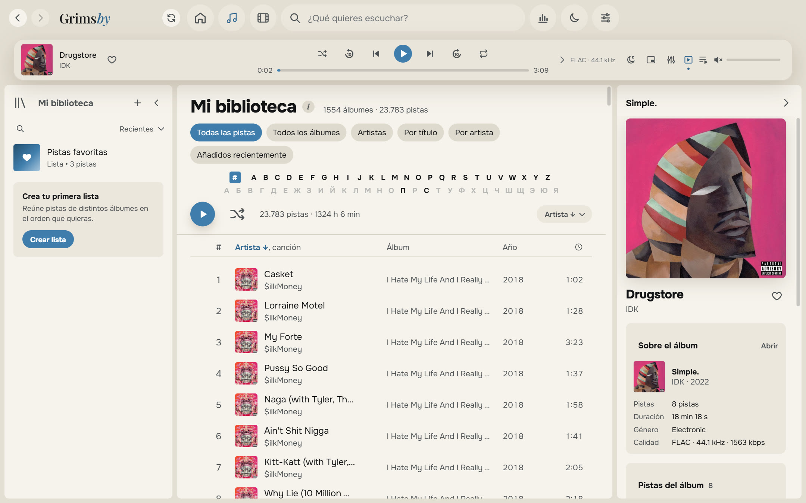

### 🖼 Aspecto propio

Elige el color de la app —tiñe botones, elementos seleccionados, enlaces y barras de progreso— y el fondo de la ventana: un color, un degradado, tu propia foto o un vídeo sin sonido. El oscurecimiento, el desenfoque del fondo y la densidad de los paneles se ajustan, y el vídeo se pausa solo cuando la ventana está minimizada o el modo **Para PC antiguos** está activado. Los ajustes están divididos en secciones con un buscador arriba.

### 🪟 Como en casa en Windows

- icono en la bandeja del sistema con menú de reproducción;
- botones anterior / pausa / siguiente en la miniatura de la barra de tareas y teclas multimedia;
- mini reproductor siempre visible;
- atajos de teclado para todo;
- la ventana se abre tal como la cerraste.

### 📅 Calendario de lanzamientos (experimental)

Actívalo en Ajustes y en Inicio verás qué álbumes cumplen años hoy —«4 años», «22 años»— y un calendario del mes con portadas en cada día. Las fechas salen de tus etiquetas; si faltan, Grimsby puede buscarlas en internet y, si quieres, guardarlas en los archivos.

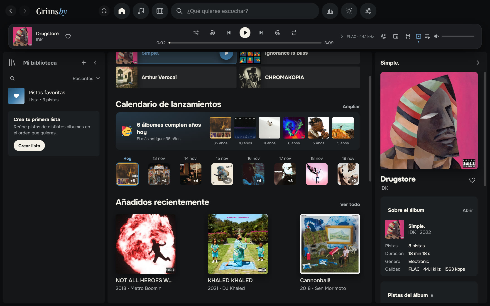

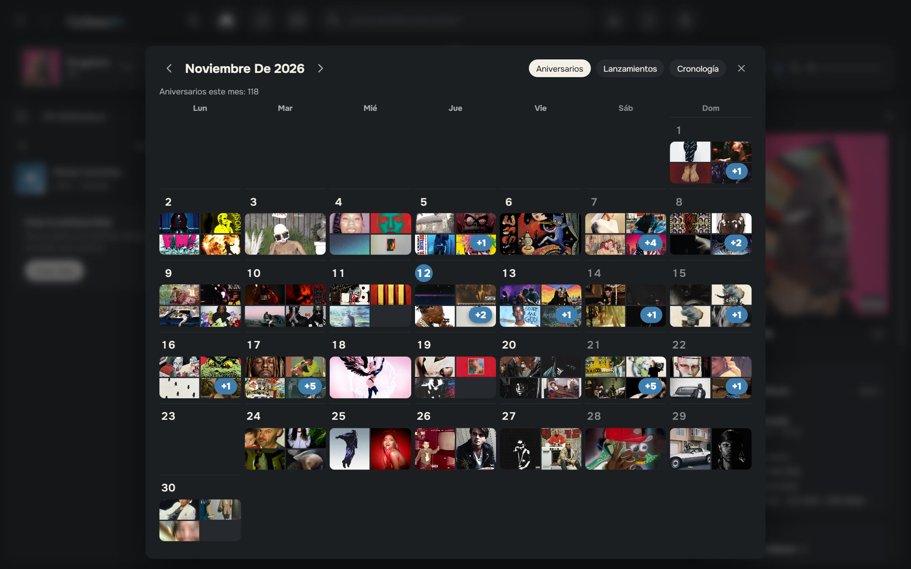

### 🌈 Destellos, barra compacta y un nuevo ecualizador

El nuevo estilo **Destellos** convierte la página del álbum en los colores de su portada fluyendo lentamente. La barra del reproductor puede ser **Compacta**: flota sobre el contenido con esquinas redondeadas y transparencia ajustable, abajo o arriba. El ecualizador se abre como un panel de cristal junto a su botón: los cambios se aplican al instante y hay más ajustes predefinidos.

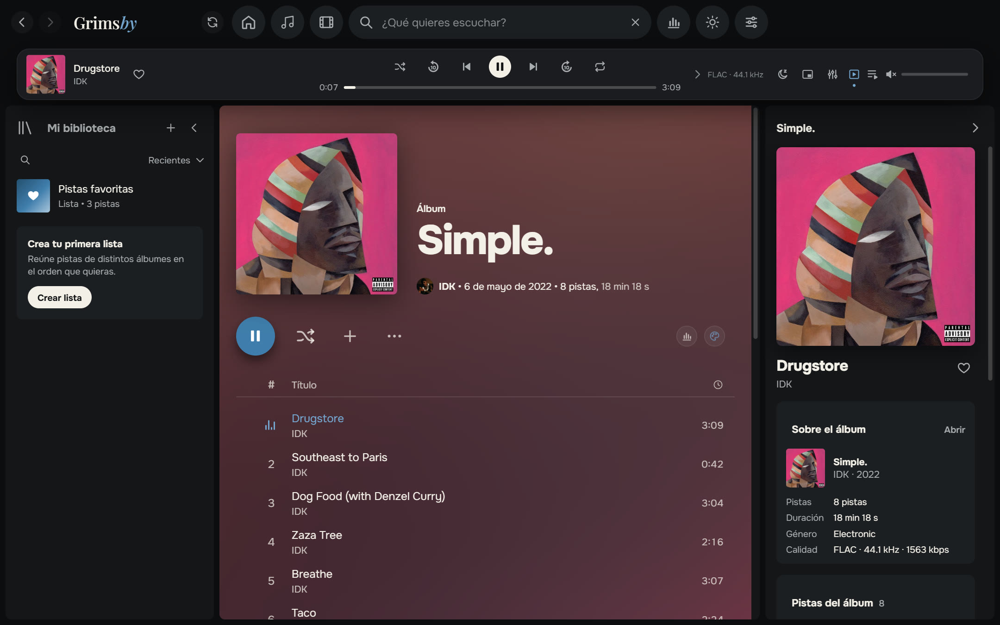

### 🗂 Orden y Compartir

Un mismo orden de álbumes para todos los años en Biblioteca y Videos, con excepciones para cualquier año, con su propio orden y sentido. Los artículos The, A y An no cuentan al ordenar: The Weeknd está en la W. **Compartir** reúne un álbum (o todos los álbumes de un artista) en un ZIP: audio, portada y, si quieres, videoclips; la opción **Más pequeño** recodifica las pistas a MP3 320 o AAC 256, y el tamaño del archivo se ve de antemano.

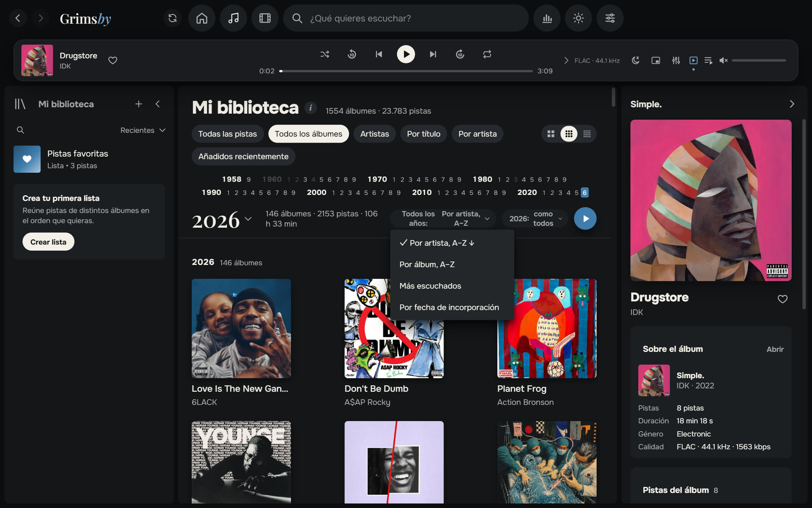

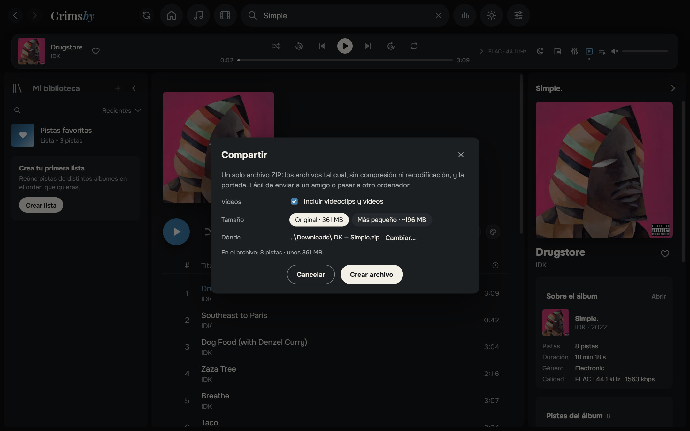

### 🧩 Las apps de Grimsby, en el propio reproductor

En Ajustes → Acerca de están **Comentarios** (Telegram, correo, GitHub) y **Apps de Grimsby**: Converter, Tagger, Prompter, Helper, Studio y Notes con descripciones y capturas. Descarga e instala con un clic.

### 🛠 Y más

- **Interfaz en 9 idiomas**: por defecto, el de tu Windows.
- **Copia de seguridad** de favoritos, listas e historial en un solo archivo.
- **Guía integrada «Cómo preparar los archivos»** en lenguaje sencillo.
- **Actualizaciones a tu manera**: «Solo avisar», «Automáticamente» o «No buscar».

---

## Descargar e instalar

1. Abre la página de la **[última versión](https://github.com/maksimkhatskevich/grimsby-releases/releases/latest)** y descarga `Grimsby-Player-Setup-X.Y.Z.exe`.
2. Ejecuta el instalador. Windows puede mostrar la ventana azul «Windows protegió su PC»: es un aviso normal para programas sin firma digital de pago. Pulsa **Más información → Ejecutar de todas formas**.
   El instalador se ha analizado en VirusTotal: [ninguno de 42 antivirus detecta nada](https://www.virustotal.com/gui/file/cd84cb09879b227d1e1acb80da62985b515666c8056d0c93bc0018b9bdd5bb0b) (versión 1.10.0).
3. En el primer inicio, elige tu carpeta de música (y, si quieres, la de videos). Grimsby hace el resto.

**Requisitos:** Windows 10 u 11 (64 bits). Internet solo hace falta para actualizaciones y fotos de artistas opcionales.

Grimsby busca nuevas versiones por sí solo y te muestra qué ha cambiado. Tus favoritos, listas, historial y ajustes se conservan.

---

## Cómo organizar tus archivos

Grimsby no te obliga a reorganizar tu colección: lee las etiquetas y entiende las formas más comunes de guardar música. Pero le gusta el orden:

```
D:\Music\
├── albums\
│   └── Tyler, The Creator\
│       └── CHROMAKOPIA\
│           ├── 01 - St. Chroma.flac          ← etiquetas: artista, álbum, año, portada incrustada
│           └── (2024) Tyler, The Creator — Noid.mp4   ← videoclip de este álbum
└── clips\
    ├── 2024\
    │   └── Kendrick Lamar — Not Like Us.mp4  ← videoclip; el año sale de la carpeta
    └── concerts\
        └── Tiny Desk Concert\
            └── Doechii — Tiny Desk.mp4       ← concierto dentro de una serie
```

Hay una guía detallada en la app: «Ajustes → Cómo preparar los archivos».

---

## Privacidad

Grimsby funciona **por completo en tu ordenador**. Sin cuentas, sin anuncios, sin analítica. Tu historial de escucha nunca sale de tu PC.
La app solo se conecta para buscar actualizaciones y, si no lo desactivas, para las fotos de artistas.

---

## Las apps de Grimsby

<table>
  <tr>
    <td align="center" width="25%"><br><b>Grimsby Player</b><br></td>
    <td align="center" width="25%"><a href="https://github.com/maksimkhatskevich/grimsby-converter/blob/main/README.es.md"><br><b>Grimsby Converter</b></a><br><sub>Video, audio, fotos y documentos, convertidos sin conexión</sub></td>
    <td align="center" width="25%"><a href="https://github.com/maksimkhatskevich/grimsby-tagger/blob/main/README.es.md"><br><b>Grimsby Tagger</b></a><br><sub>Editor de etiquetas por lotes: álbumes, portadas, nombres de archivo</sub></td>
    <td align="center" width="25%"><a href="https://github.com/maksimkhatskevich/grimsby-prompter/blob/main/README.es.md"><br><b>Grimsby Prompter</b></a><br><sub>Un teleprompter sencillo que sigue tu voz</sub></td>
  </tr>
  <tr>
    <td align="center" width="25%"><a href="https://github.com/maksimkhatskevich/grimsby-helper/blob/main/README.es.md"><br><b>Grimsby Helper</b></a><br><sub>El estado de tu PC de un vistazo: procesos, temperaturas, limpieza</sub></td>
    <td align="center" width="25%"><a href="https://github.com/maksimkhatskevich/grimsby-studio/blob/main/README.es.md"><br><b>Grimsby Studio</b></a><br><sub>Editor de video con insertos musicales animados</sub></td>
    <td align="center" width="25%"><a href="https://github.com/maksimkhatskevich/grimsby-notes/blob/main/README.es.md"><br><b>Grimsby Notes</b></a><br><sub>Tareas, proyectos, notas y calendario en una ventana</sub></td>
  </tr>
</table>

---

## Contacto

¿Encontraste un error, tienes una idea o solo quieres dar las gracias?

- ✉️ correo: **[grimsbyy@gmail.com](mailto:grimsbyy@gmail.com)**
- 🐞 errores e ideas: [Issues](https://github.com/maksimkhatskevich/grimsby-releases/issues)
- 📣 Telegram: [@itsgrimsby](https://t.me/itsgrimsby) (en ruso)

Al reportar un error, indica tu versión de Grimsby («Ajustes → Acerca de»), qué estabas haciendo y, si puedes, una captura.

---

## Licencias

Grimsby usa componentes de código abierto, entre ellos Electron, React y FFmpeg (GPL v3). La lista completa con licencias y enlaces al código fuente está en la app: «Ajustes → Acerca de».
Las portadas de las capturas pertenecen a sus titulares y se muestran como ejemplo de una biblioteca personal.

<p align="center"><sub>Hecho con amor por los álbumes · © 2026 Grimsby</sub></p>
