<p align="center">
  <a href="README.md">English</a> ·
  <a href="README.ru.md">Русский</a> ·
  <a href="README.es.md">Español</a> ·
  <a href="README.pt.md">Português</a> ·
  <a href="README.de.md">Deutsch</a> ·
  <a href="README.fr.md">Français</a> ·
  <a href="README.zh.md">中文</a> ·
  <b>日本語</b> ·
  <a href="README.ko.md">한국어</a>
</p>

<p align="center">
  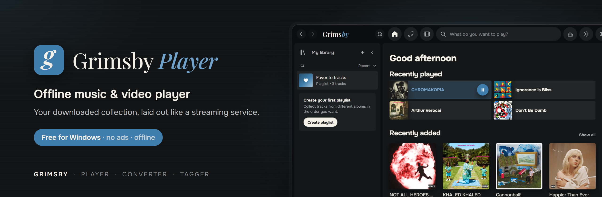
</p>

<p align="center">
  <b>アルバムをまるごと。その周りのすべても。</b><br>
  どのアルバムの横にも MV、アルバム映像、ライブを。すべてあなた自身のライブラリから。
</p>

<p align="center">
  <a href="https://github.com/maksimkhatskevich/grimsby-releases/releases/latest"></a>
  
  
  <a href="https://www.virustotal.com/gui/file/cd84cb09879b227d1e1acb80da62985b515666c8056d0c93bc0018b9bdd5bb0b"></a>
  <a href="https://github.com/maksimkhatskevich/grimsby-releases/releases"></a>
</p>

<p align="center">
  <a href="https://github.com/maksimkhatskevich/grimsby-releases/releases/latest"><b>⬇ Windows 版をダウンロード</b></a>
</p>

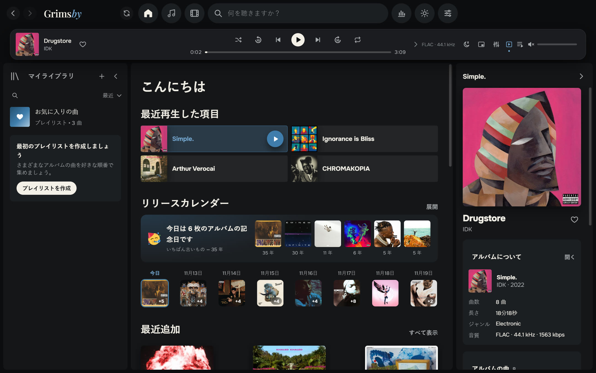

---

## アーティストが作ったとおりに、アルバムを

Grimsby にとって、アルバムは曲の寄せ集めではなくひとつの作品です。アルバムフォルダー内の動画はそのアルバムの MV に。アルバム映像やライブも音楽の横に並びます。

FLAC でアルバムをダウンロードし、ディスコグラフィーを集め、MV やライブ映像を保存している人なら、この悩みを知っているはずです。
ストリーミングアプリは見た目は素敵ですが、あなたの音楽はそこにありません。レアな作品、高音質のリッピング、ネットから消えた映像。
従来のプレーヤーはファイルを問題なく扱えますが、画面はまるで 2008 年のままです。

**Grimsby はその両方をつなぎます。** 音楽フォルダーを指定すれば、1 分後にはコレクションが美しいライブラリに変わります。
年ごとのアルバム、写真付きのアーティストページ、アルバムの隣に並ぶ MV、統計、そして年間の振り返り。
アカウントも、サブスクリプションも、広告も、インターネットも不要です。

| | ストリーミング | 従来のプレーヤー | **Grimsby** |
|---|:---:|:---:|:---:|
| 自分のファイル（FLAC、レアな作品） | ✕ | ✓ | **✓** |
| モダンで美しい画面 | ✓ | ✕ | **✓** |
| アルバムの隣に MV・ライブ・映画 | 一部 | ✕ | **✓** |
| 統計と年間の振り返り | ✓ | ✕ | **✓** |
| 変換・重複の検出・タグ編集 | ✕ | 一部 | **✓** |
| オフライン・サブスク不要 | ✕ | ✓ | **✓** |
| あなたの情報をどこにも送らない | ✕ | ✓ | **✓** |

**アルバムは要らない？** 設定でライブラリを **曲のみ** に切り替えれば、Grimsby はアルバムページのないシンプルな曲プレーヤーになります。

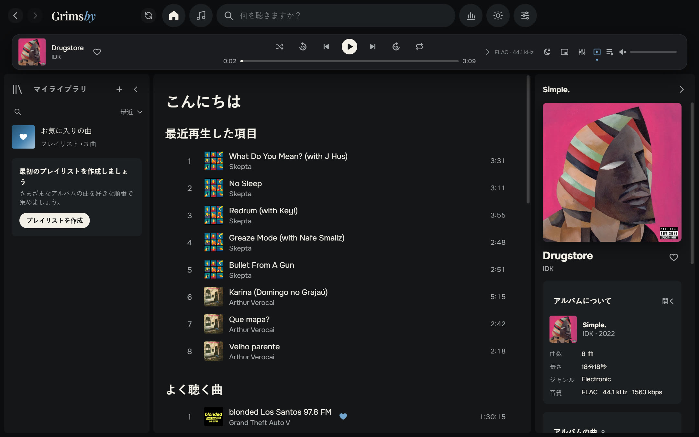

---

## 機能

### 💿 主役はアルバム

Grimsby はアルバムを通して聴くために作られています。コレクション全体がリリース年ごとに並び、上部に年のバーが表示されます。
現在の年の見出しはページ上部に固定され、クリックするとカレンダーが開いてすばやく移動できます。
「すべての曲」（列ごとに並べ替え可能）、「アーティスト」、「タイトル順」、「アーティスト別」、「最近追加」のタブと、アルファベットのバーもあります。

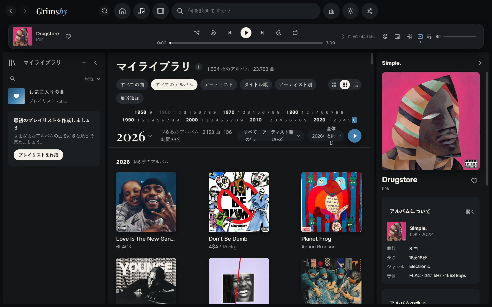

- **巨大なライブラリでも一瞬。** 23,783 曲・1,554 アルバム（286 GB）のコレクションでテスト済み。スクロールは滑らか、検索は即座です。
- **スキャンはあなたの指示どおりに：** 起動のたび、1 日 1 回、または手動のみ。既知のファイルは読み直しません。
- **MP3、FLAC、ALAC、AAC/M4A、OGG、Opus、WAV に対応。** ブラウザーエンジンで再生できない Apple Lossless は Grimsby が自動で変換します。
- **複数ディスクのアルバム** は「ディスク 1」「ディスク 2」…に分かれ、ディスクごとに番号が振られます。
- **客演アーティスト** を曲名から検出——`(feat. …)`、`(ft. …)`、`(with …)`——その曲は客演アーティストのページにも表示されます。
- **ジャケットのサイズ**：大・標準・小を、音楽と動画で別々に選べます。

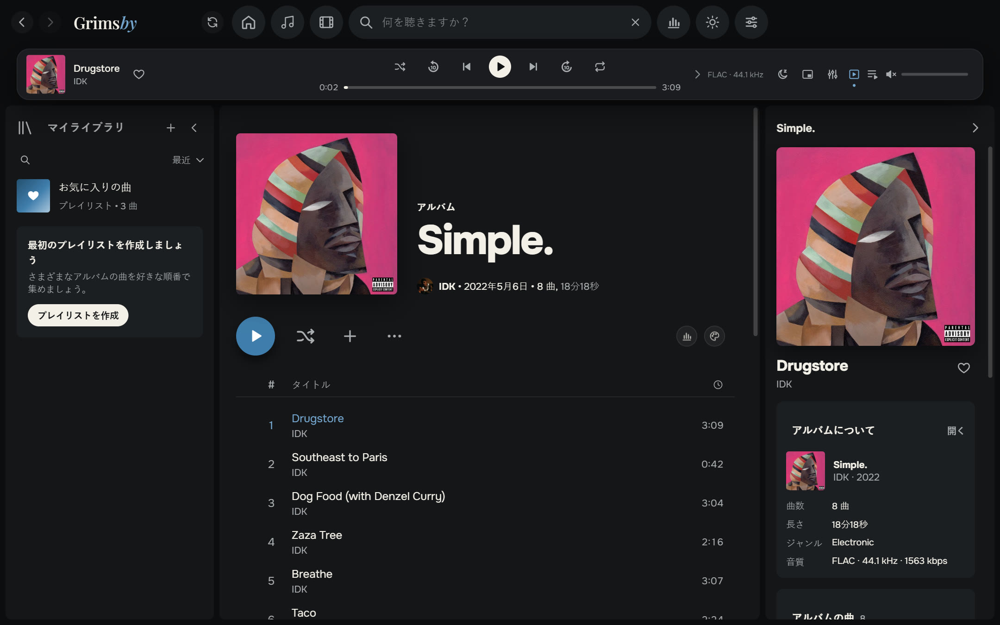

### 🎤 アーティストのすべてを 1 ページに

アルバム、シングル、MV、映画、ライブ、客演曲をひとつのページに。アーティスト写真は一度だけ取得し、その後はすべてオフラインで動きます。
アーティストラジオや「すべての動画を見る」もここから。

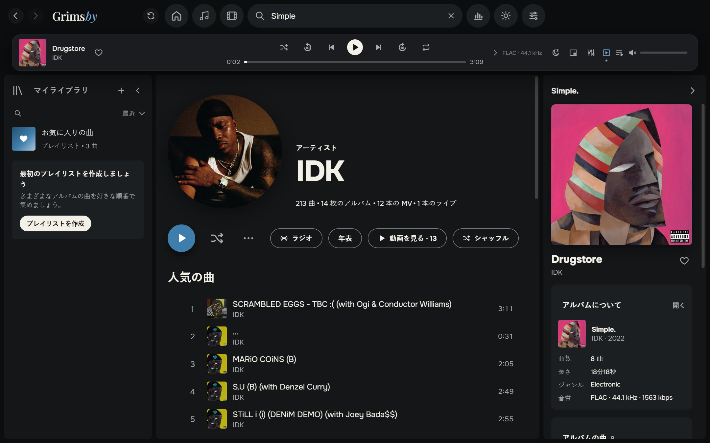

### 📈 アルバムのタイムライン

アーティストのすべてのアルバムを、年ごとの目盛りがついた 1 本のタイムラインに並べます。リリースの間隔、最も長いブランク、前作から何日たったかがわかります。好きなアルバムを 2 つクリックすると、その間の期間が表示されます。アーティストページの **年表** ボタンや、リリースカレンダーの全体表示から開けます。

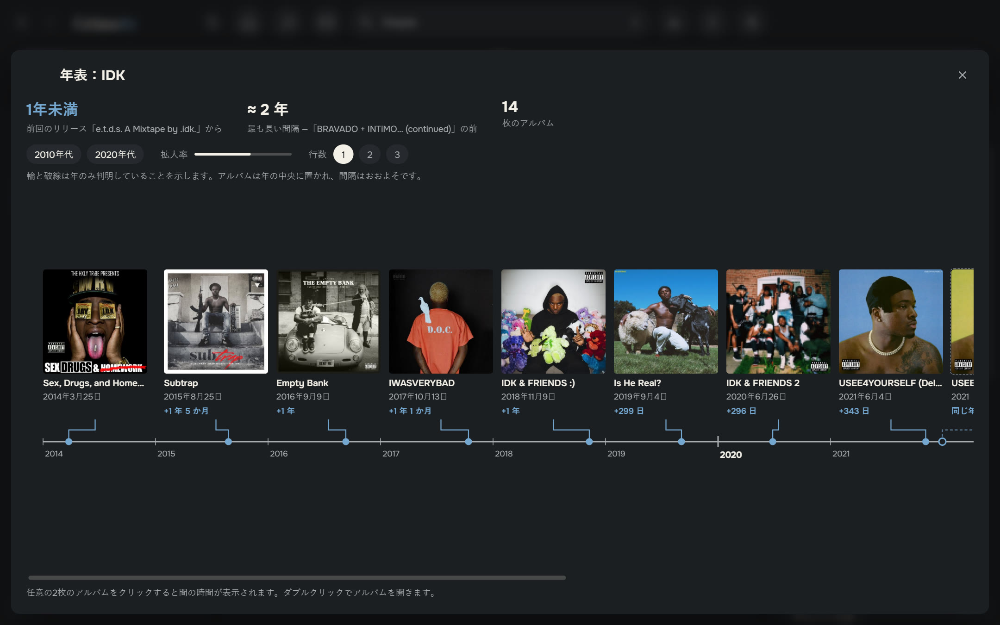

### 🔎 ジャンルと歌詞で検索

タイトルやアーティストだけでなく、ジャンルや歌詞の一節も検索できます。歌詞はタグと、曲の横にある .lrc ファイルから読み込みます。結果には、どこで一致したかが表示されます。大文字と小文字は区別せず、入力ミスで見つからないときは最も近いものを表示します。ジャンルは個別に数えるようになりました。「Pop, Hip-Hop」は、統計、ジャンルページ、イコライザーで 2 つのジャンルとして扱われます。

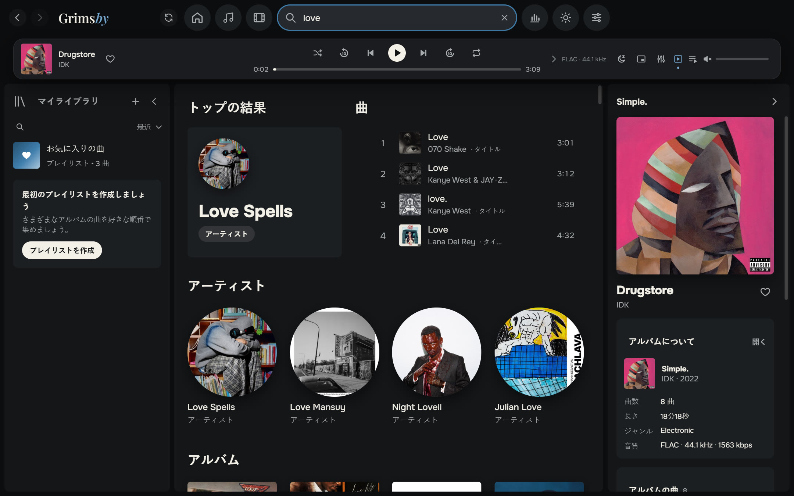

### 🎬 MV、ライブ、アルバム映画

どのストリーミングサービスにもない機能です。Grimsby は動画フォルダーを自動で整理します。

- `アーティスト — タイトル` という名前の動画は、アーティストと年ごとにまとめられます。
- アルバムフォルダー内の動画は**そのアルバムの** MV になります。
- `(Film)` が付いたファイルは**アルバム映画**になり、アルバムと映画が互いにおすすめし合います。
- `concerts` フォルダーはシリーズ別のライブセクションになります（例：*Tiny Desk Concert*）。

動画はアプリ内で再生されます。プレーヤーの隅に小さくして、ライブラリを見続けられます。
珍しいコーデック（例：4K の AV1）のファイルでも、Grimsby が互換性のあるコピーを自動で用意します。
曲にミュージックビデオがあれば、プレーヤーに **ミュージックビデオを見る** ボタンが表示されます。ビデオからは **曲を聴く** で同じ位置から曲に戻れます。

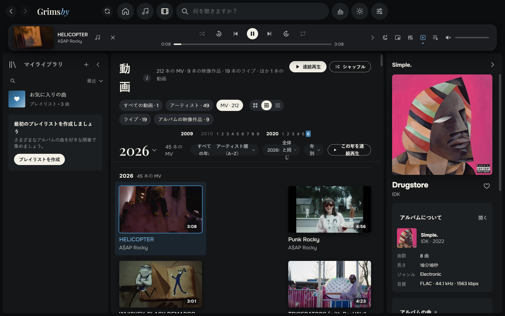

MV は見ない？ 設定のスイッチひとつで動画セクションごと非表示にできます。

### 🧰 ライブラリをきれいに保つ

- **ファイル変換**：MP3、AAC（M4A）、Opus、OGG、FLAC、ALAC、WAV。タグとジャケットも引き継がれます。別のフォルダーにコピーを保存するか、元のファイルを置き換えるかを選べます。古いファイルはごみ箱へ移り、お気に入りやプレイリストは新しいファイルに引き継がれます。曲はチェックボックスで選べます。
- **重複の検出**：別々のファイルに入った同じ曲や、アルバムフォルダーのコピーを見つけ、それぞれのフォルダー・形式・ビットレートを表示します。重複でなければ「問題ありません」を押せば、Grimsby が覚えておきます。
- **ライブラリの健康状態** を表情アイコン 😊 😐 😟 で表示：ジャケット・年・ジャンルのないアルバム、番号のない曲、読み込めないファイル——そして直し方も。
- **発売日のないアルバム** — 完全な日付がないアルバムの一覧。選んだアルバムの日付をまとめてネットで探すことも、手で入力することもできます。日付は Grimsby の中だけに保存することも、タグに書き込むこともできます。
- **詳細を編集**：アルバム全体のタグとジャケットをまとめて編集、ディスクの分割も可能。変更前にファイルをバックアップします。

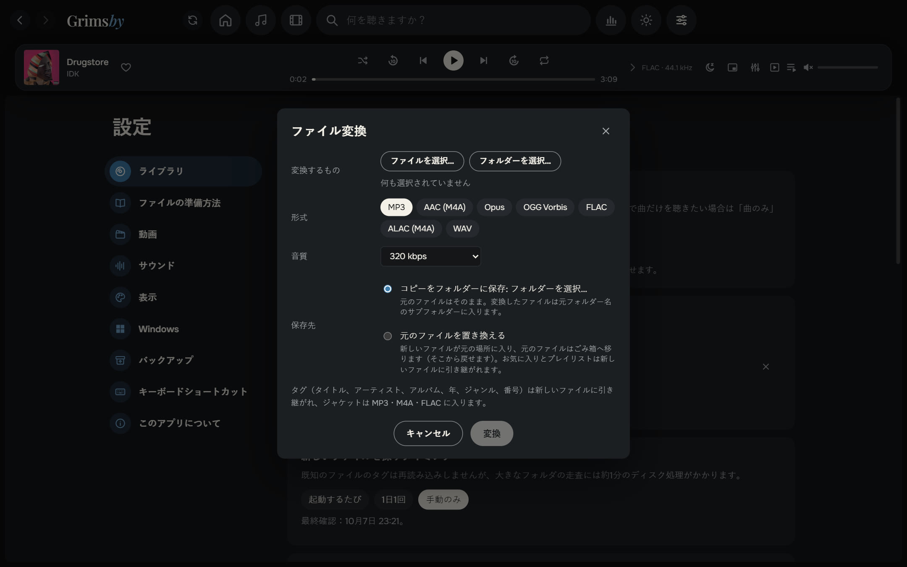

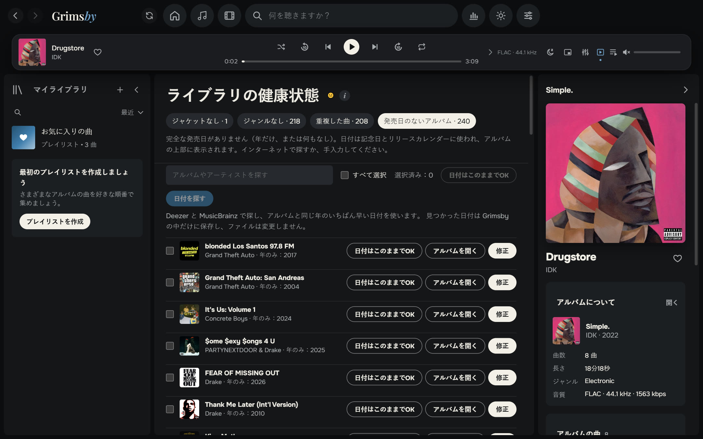

### 🔊 本格的なプレーヤーの音

- **ギャップレス再生**——コンセプトアルバムも曲間の途切れなしで再生。
- **2〜12 秒のクロスフェード**。同じアルバム内では自動でオフになります。
- **音量の自動調整（ReplayGain / LUFS）**：スマート、曲ごと、アルバムごと。
- **10 バンドイコライザー**とプリセット：ヒップホップ、R&B、低音強調、ボーカル、小音量など。
- **スリープタイマー、常に最前面のミニプレーヤー、「次に再生」、ドラッグ＆ドロップできる再生キュー。**
- **長い曲やミックス** は止めたところから再開します。

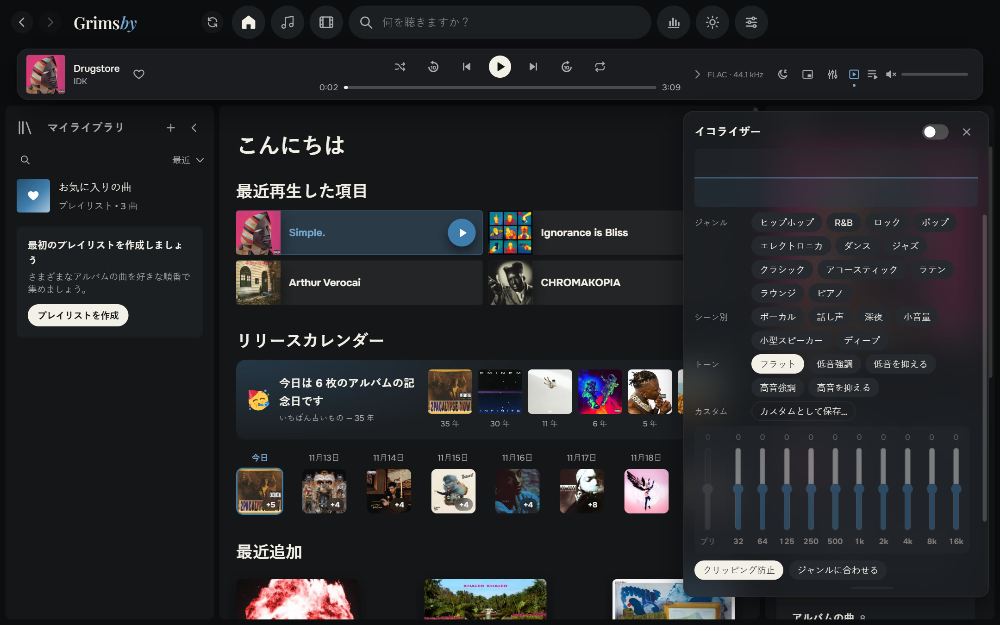

### 📻 自分で育つプレイリスト

- **スマートプレイリスト**。**「ラジオ：マイミックス」**——よく聴く曲に、ジャンルや年代の近い曲を混ぜたもの——や、ひとりのアーティストやジャンルを中心にした **アーティストのラジオ** もあります。
- サイドパネルのプレイリストやフォルダーは **自分の順番** に並べられ、並べ替えを切り替えて戻っても保たれます。
- 「お気に入りの曲」やプレイリストを番号・アーティスト・タイトル・アルバム・長さで並べ替え——メニューからでも、列見出しのクリックでも。
- プレイリストにはカバーと説明を自由に設定できます。

### 📊 数字好きのための統計

**再生**：週・月・年・全期間。分数や再生回数によるアーティスト・アルバム・曲のランキング、音楽を聴いた連続日数。数字は再生中にリアルタイムで更新されます。
**コレクション**：曲数、アルバム数、ジャンル数、容量、総再生時間、ロスレスの割合——そして**一度も再生していない**アルバムの数。
**アルバムの統計**：どのアルバムでも、どれくらいの頻度で聴いているか、実際にどこまで聴いているか、どの曲を飛ばしているかがわかります。過去の週・月・年は矢印でさかのぼれます。

アーティストやアルバムは統計画面からランキングで非表示にでき、**非表示** から戻せます。**聴くのにかかる時間** では、ライブラリ全体、再生済みと未再生、1 日 1・2・4 時間聴いた場合に何日で聴き終わるかがわかります。

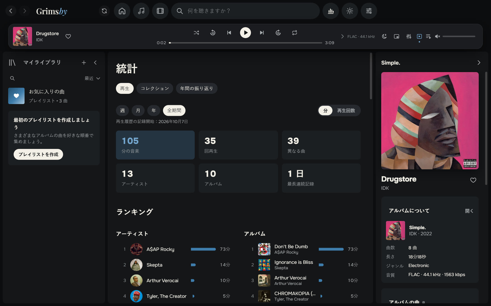

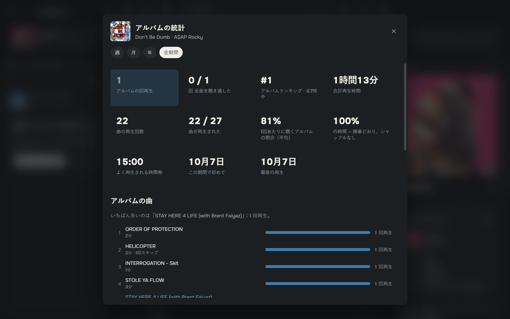

### 🎁 年間の振り返り

12 月 1 日から 1 月 15 日まで、Grimsby が年間の振り返りを贈ります。今年のアーティスト、今年のアルバム、お気に入りの曲、記録、新しい発見、そしてあなたのリスナータイプ
（「一途なファン」「開拓者」「夜型」「マラソン派」…）。各カードはストーリー用の画像として保存でき、ダーク／ライトテーマに対応しています。

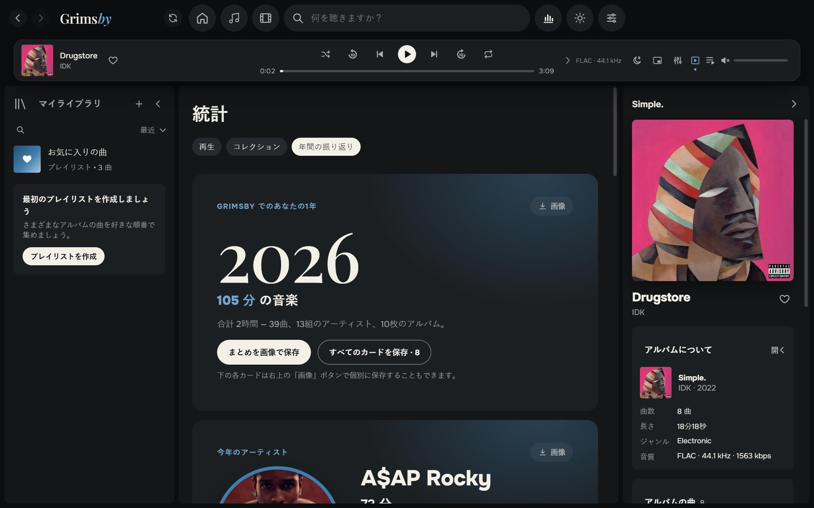

### 🎨 ダーク／ライトテーマとジャケットの色

Grimsby を象徴するブルー、グラファイト、そして「紙」の色。テーマを選ぶか、Windows に合わせることができます。アルバムやプレイリストのページをジャケットの色に染められます——やわらかな光から全面塗りまで、ページ上のパレットボタンで切り替え。

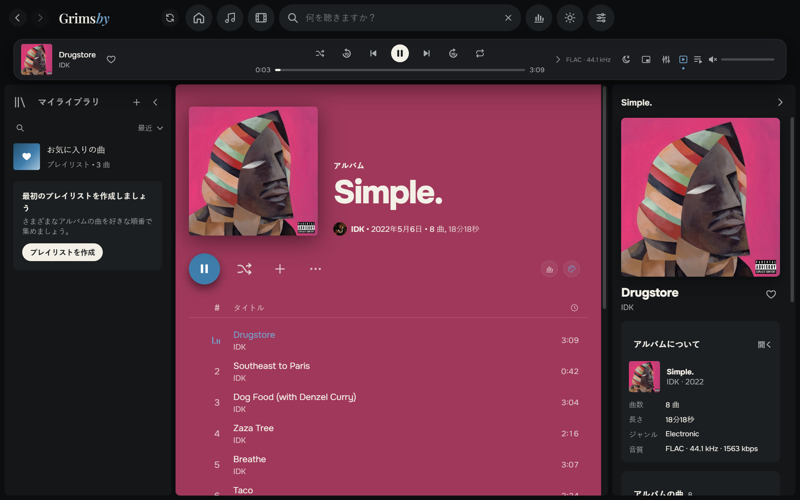

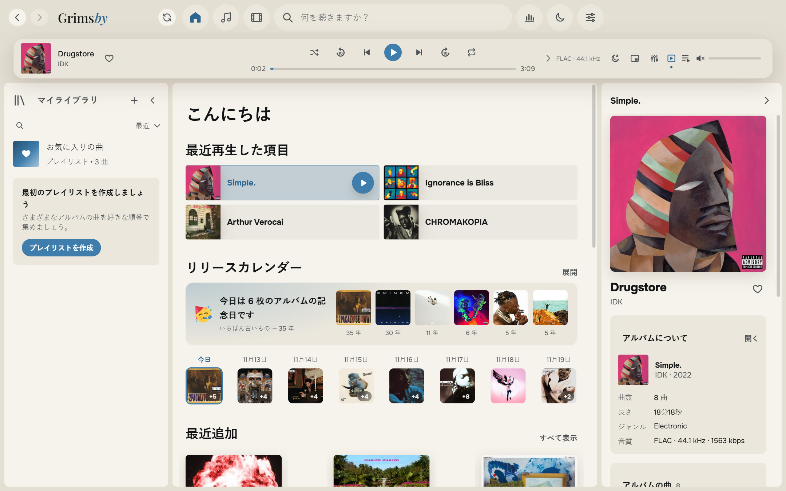

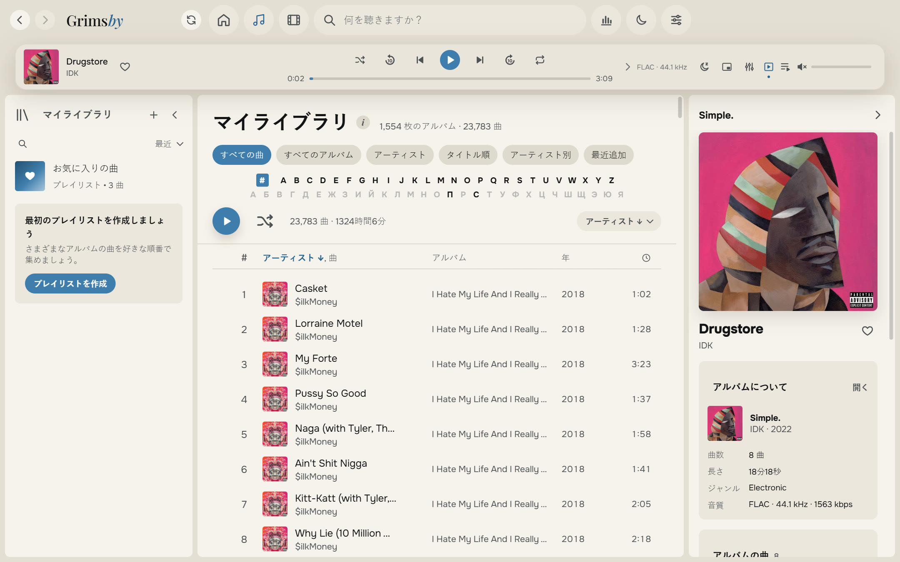

### 🖼 自分好みの見た目

アプリの色（ボタン、選択項目、リンク、進行バーに使われます）とウィンドウの背景（単色、グラデーション、自分の写真、音なしの動画）を選べます。暗さ、背景のぼかし、パネルの濃さも調整でき、ウィンドウを最小化したときや **低スペックPC向け** モードでは動画が自動で一時停止します。設定はセクションに分かれ、上に検索があります。

### 🪟 Windows にしっかりなじむ

- 再生メニュー付きの通知領域アイコン
- タスクバーのサムネイルに前へ／一時停止／次へボタン、メディアキーにも対応
- 常に最前面のミニプレーヤー
- あらゆる操作にキーボードショートカット
- 閉じたときと同じ状態でウィンドウが開く

### 📅 リリースカレンダー（試験的）

設定でオンにすると、ホームに今日が記念日のアルバム（「4 年」「22 年」）と、日ごとにカバーが並ぶ月のカレンダーが表示されます。日付はタグから取得し、ない場合はネットで探して、希望すればファイルに書き込めます。

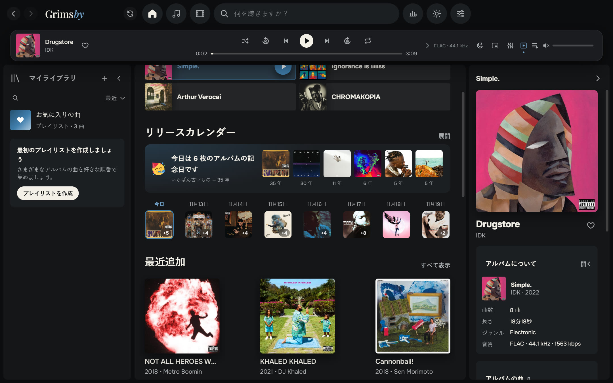

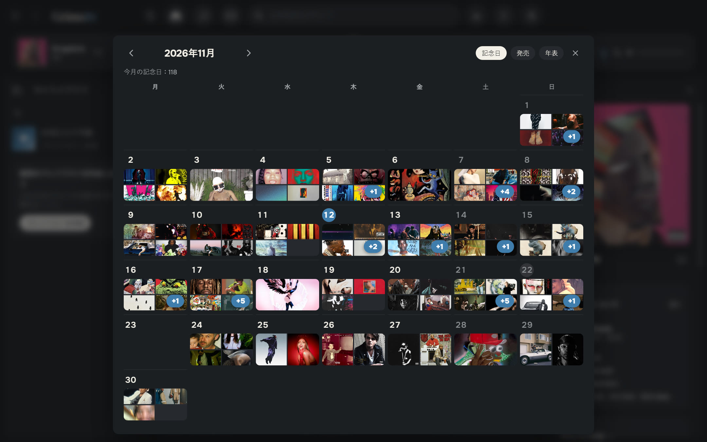

### 🌈 ゆらめき、コンパクトなバー、新しいイコライザー

新しいスタイル **ゆらめき** は、アルバムページをカバーの色がゆっくり流れる画面に変えます。プレーヤーバーは **コンパクト** にでき、角が丸く透明度も調整できるバーが内容の上に浮かびます（下にも上にも置けます）。イコライザーはボタンのすぐ横にガラスのパネルで開き、変更はすぐ反映。プリセットも増えました。

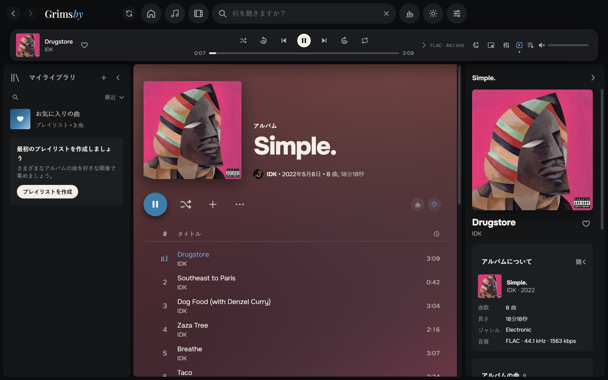

### 🗂 並べ替えと共有

「ライブラリ」と「ビデオ」のアルバムの並び順はすべての年で共通になり、どの年にも独自の順序と方向で例外を設定できます。並べ替えでは冠詞 The、A、An を無視します。The Weeknd は W に並びます。**共有** は、アルバム（またはアーティストの全アルバム）を 1 つの ZIP にまとめます。音声、カバー、必要なら MV も。**小さく** を選ぶと曲を MP3 320 または AAC 256 に変換し、アーカイブのサイズは事前に表示されます。

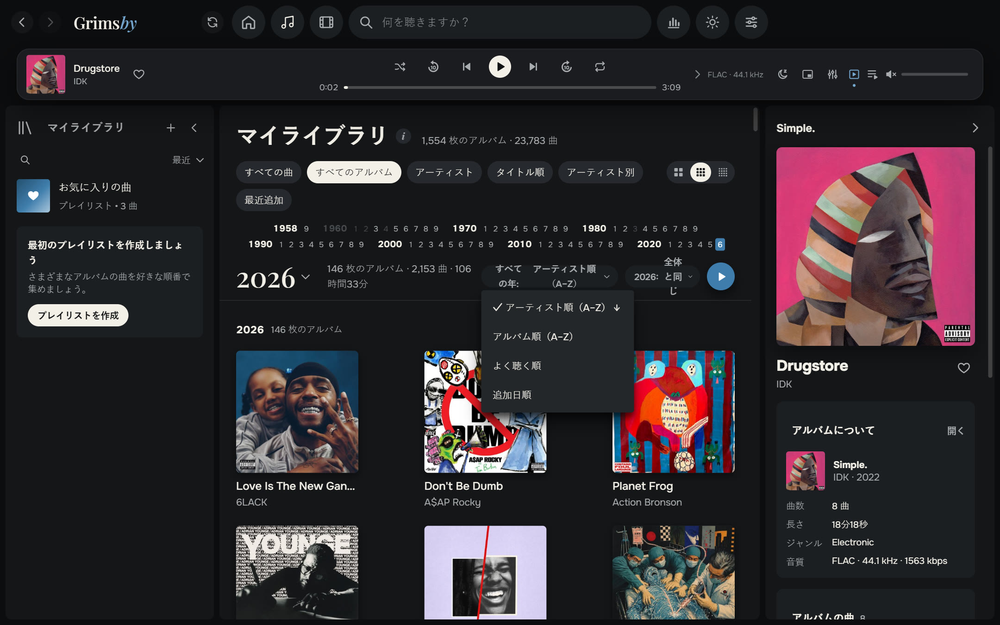

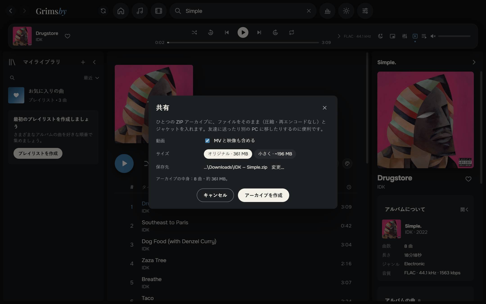

### 🧩 プレーヤーから Grimsby のアプリへ

設定 → 情報 に **フィードバック**（Telegram、メール、GitHub）と **Grimsby アプリ** があります。Converter、Tagger、Prompter、Helper、Studio、Notes を説明とスクリーンショット付きで紹介し、ワンクリックでダウンロードとインストールができます。

### 🛠 そのほか

- **9 言語に対応した画面**：既定では Windows の言語で表示。
- **バックアップ**：お気に入り、プレイリスト、履歴をひとつのファイルに。
- **組み込みガイド「ファイルの準備方法」**：わかりやすい言葉で。
- **アップデートは好みで**：「通知のみ」「自動」「確認しない」。

---

## ダウンロードとインストール

1. **[最新バージョン](https://github.com/maksimkhatskevich/grimsby-releases/releases/latest)**のページを開き、`Grimsby-Player-Setup-X.Y.Z.exe` をダウンロードします。
2. インストーラーを実行します。Windows に青い「Windows によって PC が保護されました」画面が表示されることがあります。これは有料のコード署名がないアプリでよく出る警告です。**詳細情報 → 実行** をクリックしてください。
   インストーラーは VirusTotal で確認済みです：[42 のウイルス対策エンジンすべてで検出なし](https://www.virustotal.com/gui/file/cd84cb09879b227d1e1acb80da62985b515666c8056d0c93bc0018b9bdd5bb0b)（バージョン 1.10.0）。
3. 初回起動時に音楽フォルダー（必要なら動画フォルダーも）を選べば、あとは Grimsby におまかせです。

**動作環境：** Windows 10 または 11（64 ビット）。インターネットはアップデートと任意のアーティスト写真にのみ使います。

Grimsby は新しいバージョンを自動で確認し、変更点を表示します。お気に入り、プレイリスト、履歴、設定はそのまま残ります。

---

## ファイルの整理のしかた

Grimsby はコレクションの並べ替えを強制しません。タグを読み取り、よくある保存方法を理解します。ただ、整理されているのが好きです。

```
D:\Music\
├── albums\
│   └── Tyler, The Creator\
│       └── CHROMAKOPIA\
│           ├── 01 - St. Chroma.flac          ← タグ：アーティスト、アルバム、年、埋め込みジャケット
│           └── (2024) Tyler, The Creator — Noid.mp4   ← このアルバムの MV
└── clips\
    ├── 2024\
    │   └── Kendrick Lamar — Not Like Us.mp4  ← MV。年はフォルダー名から
    └── concerts\
        └── Tiny Desk Concert\
            └── Doechii — Tiny Desk.mp4       ← シリーズ内のライブ
```

詳しいガイドはアプリ内にあります：「設定 → ファイルの準備方法」。

---

## プライバシー

Grimsby は**すべてあなたのパソコン上で動作します**。アカウントも広告も解析もありません。再生履歴が PC の外に出ることはありません。
インターネットに接続するのは、アップデートの確認と、オフにしていなければアーティスト写真の取得のときだけです。

---

## Grimsby のアプリ

<table>
  <tr>
    <td align="center" width="25%"><br><b>Grimsby Player</b><br></td>
    <td align="center" width="25%"><a href="https://github.com/maksimkhatskevich/grimsby-converter/blob/main/README.ja.md"><br><b>Grimsby Converter</b></a><br><sub>動画・音声・写真・文書をオフラインで変換</sub></td>
    <td align="center" width="25%"><a href="https://github.com/maksimkhatskevich/grimsby-tagger/blob/main/README.ja.md"><br><b>Grimsby Tagger</b></a><br><sub>タグ一括編集：アルバム、カバー、ファイル名</sub></td>
    <td align="center" width="25%"><a href="https://github.com/maksimkhatskevich/grimsby-prompter/blob/main/README.ja.md"><br><b>Grimsby Prompter</b></a><br><sub>声についてくる、シンプルなプロンプター</sub></td>
  </tr>
  <tr>
    <td align="center" width="25%"><a href="https://github.com/maksimkhatskevich/grimsby-helper/blob/main/README.ja.md"><br><b>Grimsby Helper</b></a><br><sub>PC の状態がひと目でわかる：プロセス、温度、クリーンアップ</sub></td>
    <td align="center" width="25%"><a href="https://github.com/maksimkhatskevich/grimsby-studio/blob/main/README.ja.md"><br><b>Grimsby Studio</b></a><br><sub>アニメーション付き音楽インサートが作れる動画エディター</sub></td>
    <td align="center" width="25%"><a href="https://github.com/maksimkhatskevich/grimsby-notes/blob/main/README.ja.md"><br><b>Grimsby Notes</b></a><br><sub>タスク、プロジェクト、ノート、カレンダーをひとつのウィンドウで</sub></td>
  </tr>
</table>

---

## フィードバック

不具合を見つけた、アイデアがある、ひとことお礼を言いたい——どれでも歓迎です。

- ✉️ メール：**[grimsbyy@gmail.com](mailto:grimsbyy@gmail.com)**
- 🐞 不具合とアイデア：[Issues](https://github.com/maksimkhatskevich/grimsby-releases/issues)
- 📣 Telegram：[@itsgrimsby](https://t.me/itsgrimsby)（ロシア語）

不具合を報告するときは、Grimsby のバージョン（「設定 → このアプリについて」）、そのとき何をしていたか、可能ならスクリーンショットを添えてください。

---

## ライセンス

Grimsby は Electron、React、FFmpeg（GPL v3）などのオープンソースコンポーネントを使用しています。ライセンス本文とソースコードへのリンクを含む一覧はアプリ内にあります：「設定 → このアプリについて」。
スクリーンショットのジャケットは各権利者に帰属し、個人ライブラリの例として表示しています。

<p align="center"><sub>アルバムへの愛を込めて · © 2026 Grimsby</sub></p>
