<p align="center">
  <b>English</b> ·
  <a href="README.ru.md">Русский</a> ·
  <a href="README.es.md">Español</a> ·
  <a href="README.pt.md">Português</a> ·
  <a href="README.de.md">Deutsch</a> ·
  <a href="README.fr.md">Français</a> ·
  <a href="README.zh.md">中文</a> ·
  <a href="README.ja.md">日本語</a> ·
  <a href="README.ko.md">한국어</a>
</p>

<p align="center">
  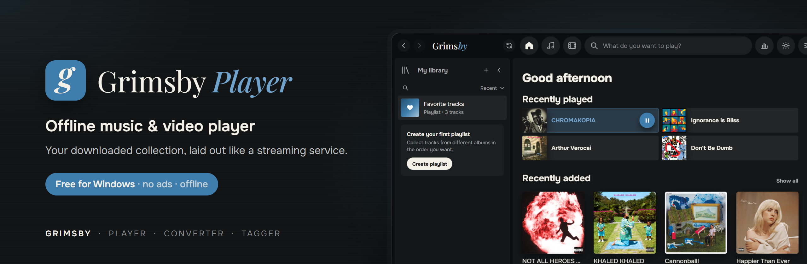
</p>

<p align="center">
  <b>The whole album. And everything around it.</b><br>
  Music videos, album films and live shows next to every album — all from your own library.
</p>

<p align="center">
  <a href="https://github.com/maksimkhatskevich/grimsby-releases/releases/latest"></a>
  
  
  <a href="https://www.virustotal.com/gui/file/71d859507b669356dfe6d90c2416438eb28aeb83389cb11c2a2ee5040d427799"></a>
  <a href="https://github.com/maksimkhatskevich/grimsby-releases/releases"></a>
</p>

<p align="center">
  <a href="https://github.com/maksimkhatskevich/grimsby-releases/releases/latest"><b>⬇ Download for Windows</b></a>
  &nbsp;·&nbsp;
  <a href="#features">Features</a>
  &nbsp;·&nbsp;
  <a href="#how-to-organize-your-files">Organizing files</a>
  &nbsp;·&nbsp;
  <a href="#feedback">Feedback</a>
</p>

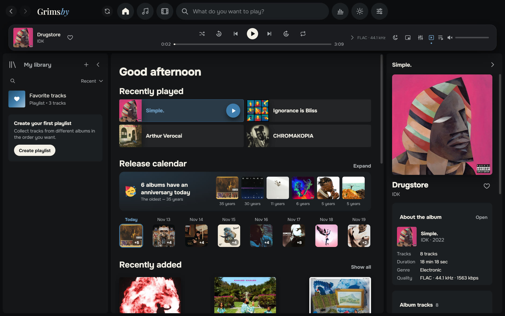

---

## Albums, the way artists made them

Grimsby treats an album as a whole work, not a pile of tracks. A video inside an album folder becomes that album's music video; album films and concerts sit next to the music.

If you download albums in FLAC, collect discographies and keep music videos and live sets, you know the problem.
Streaming apps look great, but your music isn't there: rare releases, quality rips, videos that disappeared from the internet.
Classic players handle your files just fine — but their interface feels stuck in 2008.

**Grimsby brings the two together.** Point it at your music folder, and a minute later your collection becomes a beautiful library:
albums by year, artist pages with photos, music videos next to albums, stats and a yearly recap.
No accounts, no subscriptions, no ads, no internet required.

| | Streaming | Classic player | **Grimsby** |
|---|:---:|:---:|:---:|
| Your own files (FLAC, rare releases) | ✕ | ✓ | **✓** |
| Modern, beautiful interface | ✓ | ✕ | **✓** |
| Music videos, concerts and films next to albums | partly | ✕ | **✓** |
| Stats and a yearly recap | ✓ | ✕ | **✓** |
| Converter, duplicate finder, tag editor | ✕ | partly | **✓** |
| Works offline, no subscription | ✕ | ✓ | **✓** |
| Sends nothing about you anywhere | ✕ | ✓ | **✓** |

**Not into albums?** Switch the library to **Tracks only** in Settings — Grimsby becomes a simple player for your tracks, without album pages.

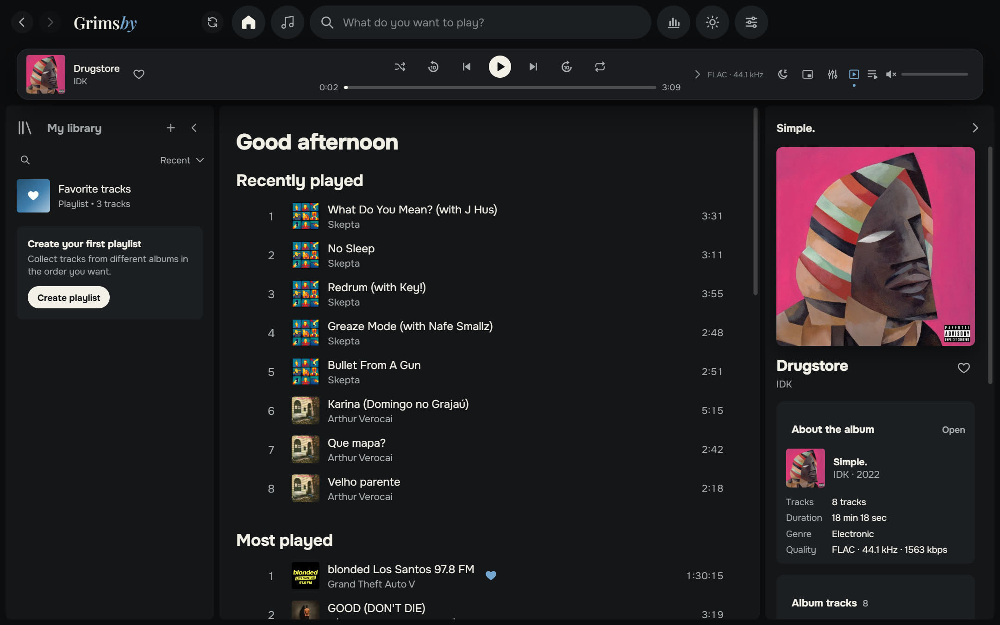

---

## Features

### 💿 Albums come first

Grimsby is built for listening to whole albums. Your entire collection is laid out by release year: a year strip on top,
the current year's header sticks to the top of the page, and clicking it opens a calendar for quick jumps.
There are also tabs for All tracks (sortable by column), Artists, By title, By artist and Recently added — plus an alphabet strip.

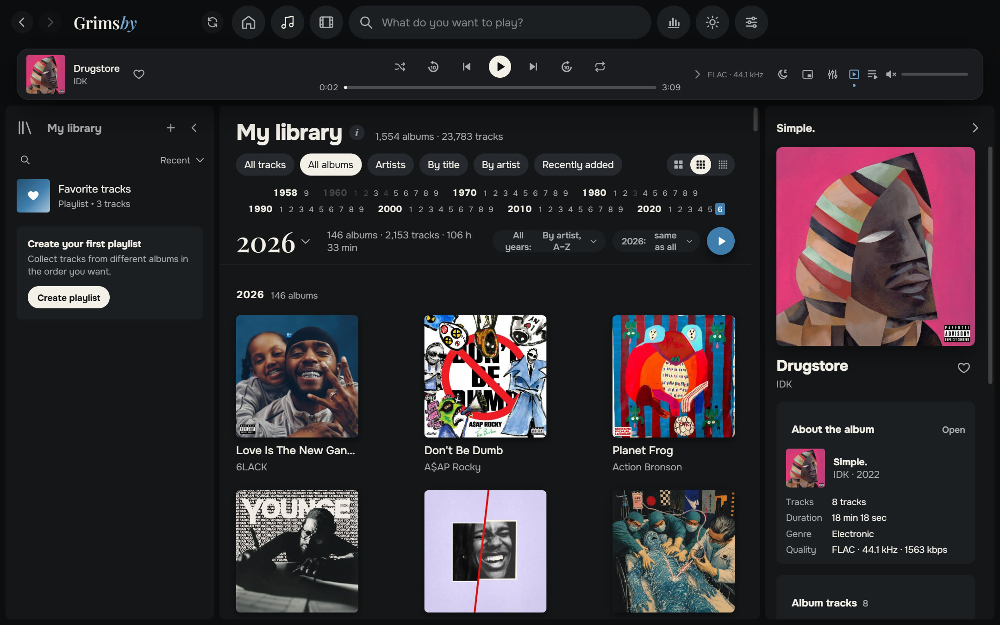

- **Instant even on a huge library.** Tested on a collection of 23,783 tracks and 1,554 albums (286 GB): smooth scrolling, instant search.
- **Scans only when you say so:** on every launch, once a day or manually. Files it already knows aren't read again.
- **MP3, FLAC, ALAC, AAC/M4A, OGG, Opus and WAV.** Grimsby quietly converts Apple Lossless, which browser engines can't play.
- **Multi-disc albums** are split into Disc 1, Disc 2… with numbering inside each disc.
- **Featured artists** are found in track titles — `(feat. …)`, `(ft. …)`, `(with …)` — and the tracks show up on their pages too.
- **Cover size** — large, normal or small, separately for music and videos.

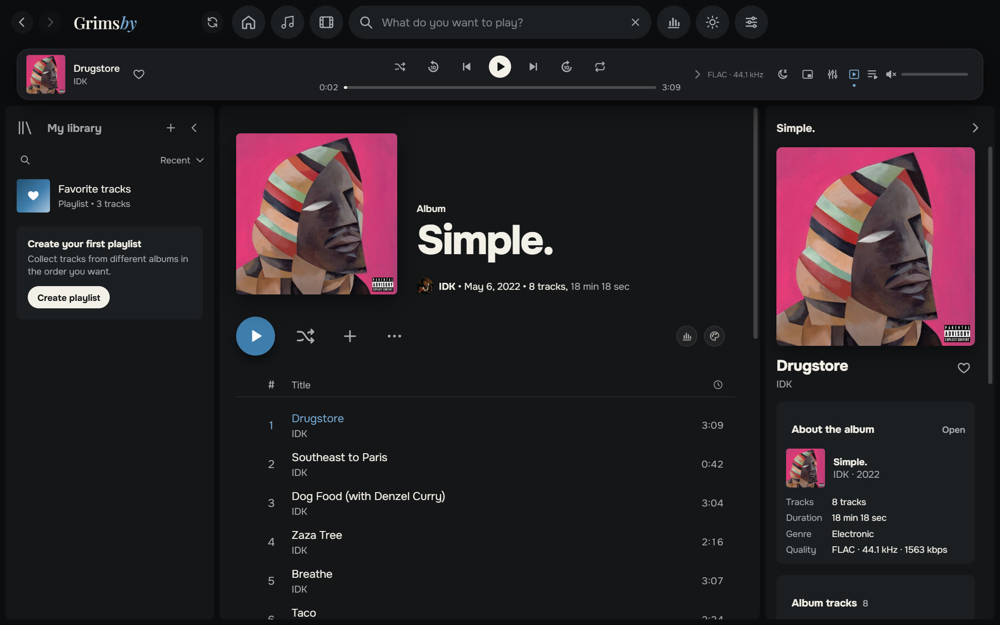

### 🎤 An artist's whole story on one page

Albums, singles, music videos, films, concerts and features on a single page. Grimsby downloads artist photos once — after that everything works offline.
Artist radio and "Watch all videos" are right there.

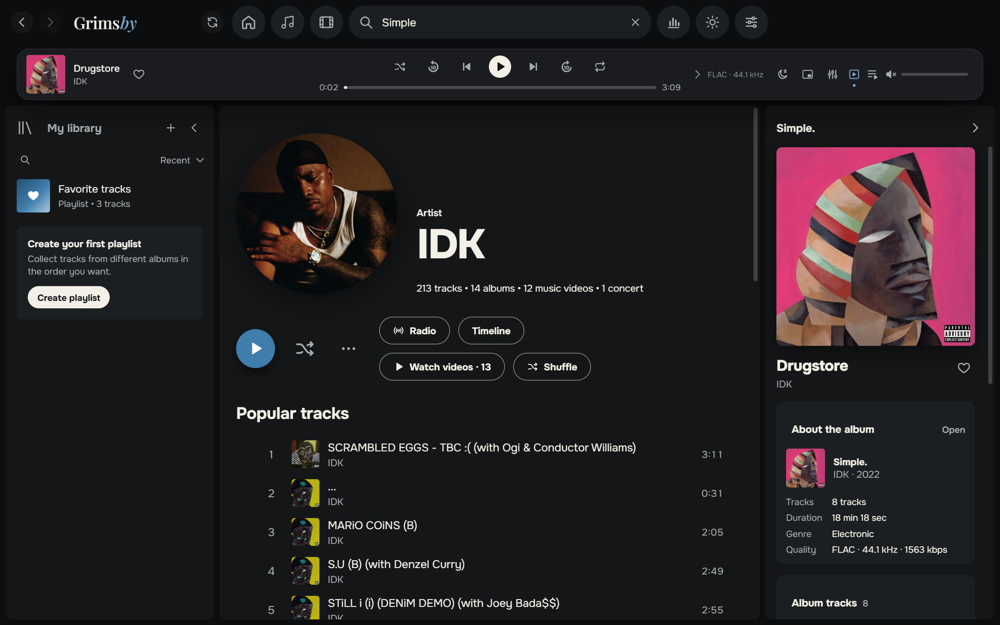

### 📈 Album timeline

All of an artist’s albums on one timeline with year marks: how long passed between releases, the longest break and how many days since the latest album. Click any two albums to see the time between them. Open it with the **Timeline** button on the artist page or from the full release calendar.

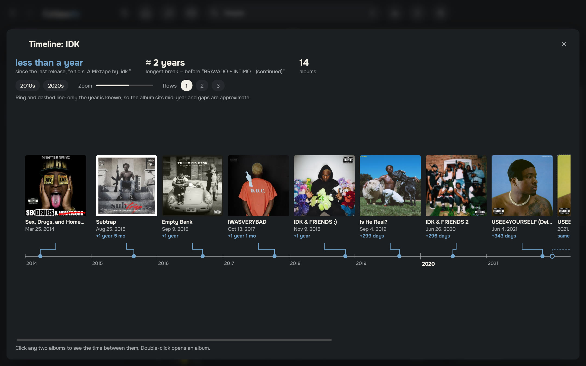

### 🔎 Search by genre and lyrics

Search finds not only titles and artists but also genres and lines from song lyrics — from tags and .lrc files next to the track. Results show where the match was found. Case doesn’t matter, and if a typo finds nothing, Grimsby shows the closest match. Genres now count separately: “Pop, Hip-Hop” is two genres in stats, on genre pages and in the equalizer.

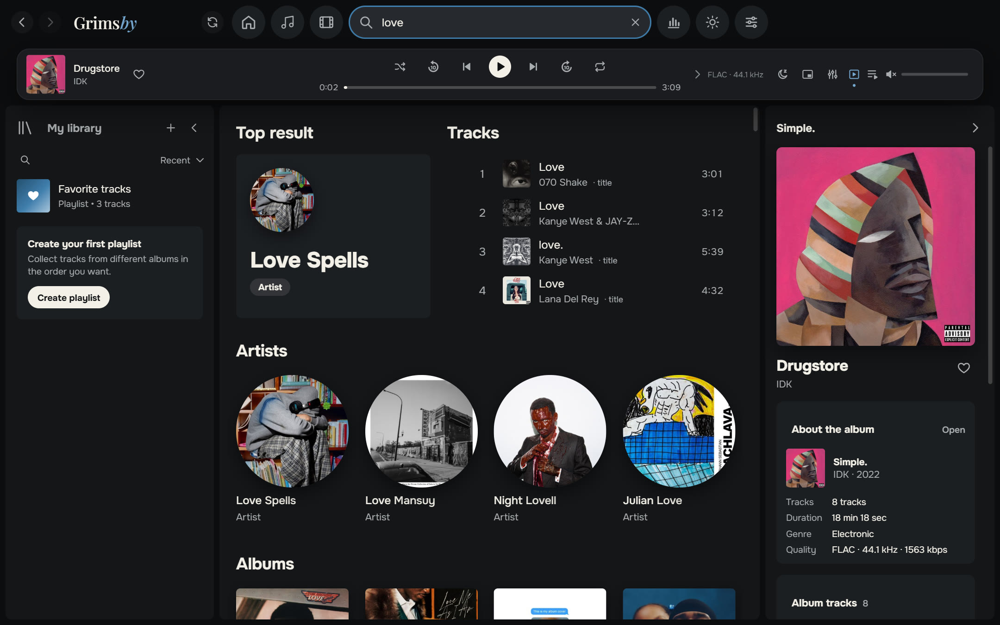

### 🎬 Music videos, concerts and album films

This is something no streaming service has. Grimsby sorts your video folder for you:

- videos named `Artist — Title` are grouped by artist and year;
- a video inside an album folder becomes a music video **of that album**;
- files marked `(Film)` become **album films**, and the album and its film recommend each other;
- a `concerts` folder turns into a concerts section with series (for example, *Tiny Desk Concert*).

Videos play right inside the app. Shrink one into the corner of the player and keep browsing your library.
If a file uses a rare codec (say, AV1 in 4K), Grimsby prepares a compatible copy by itself — no need to hunt for another player.
If a song has a music video, a **Watch the video** button appears in the player; from the video, **Play the track** switches back to the song at the same moment.

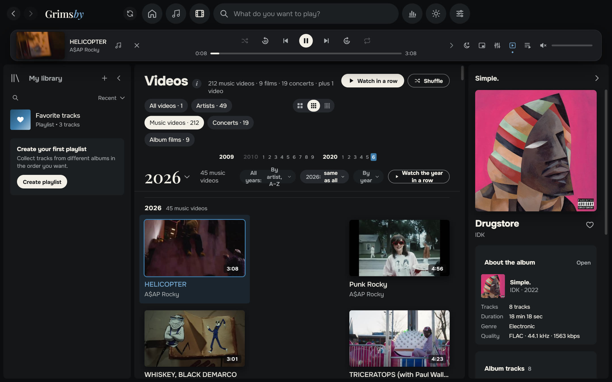

Don't watch videos? Turn the whole section off with a single switch in settings.

### 🧰 Keeps your library tidy

- **File converter** — MP3, AAC (M4A), Opus, OGG, FLAC, ALAC and WAV. Tags and covers carry over. Save copies to a separate folder or replace the originals: old files go to the Recycle Bin, and your likes and playlists move to the new ones. Pick the tracks you need with checkboxes.
- **Duplicate finder** — the same track in different files and copies of whole album folders, with the folder, format and bitrate of each copy. Not a duplicate? Click "All good" and Grimsby remembers.
- **Library health** with a mood face 😊 😐 😟: albums without a cover, year or genre, tracks without numbers, unreadable files — and how to fix them.
- **Albums without a release date** — a list of albums without a full date: find dates online for all selected albums at once or type them in, keep them in Grimsby only or write them into the tags.
- **Edit details** — tags and cover art for a whole album at once, including splitting it into discs. Grimsby backs up the files before changing them.

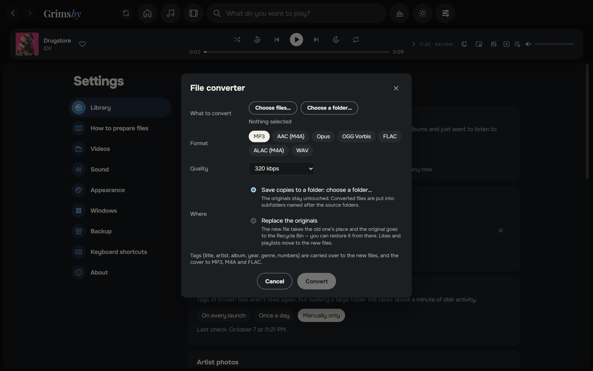

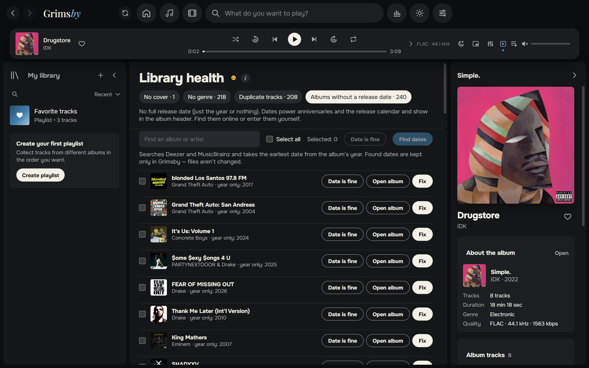

### 🔊 Sound like a proper player

- **Gapless playback** — concept albums play without pauses between tracks.
- **Smooth crossfade from 2 to 12 seconds**, automatically skipped within one album so intended transitions stay intact.
- **Volume leveling (ReplayGain / LUFS)** — smart, per track or per album. An old remaster and a new release sound equally loud.
- **10-band equalizer** with presets: Hip-hop, R&B, More bass, Vocal, Quiet listening and more.
- **Sleep timer, an always-on-top mini player, Play next and drag-and-drop in the queue.**
- **Long tracks and mixes** resume where you left off.

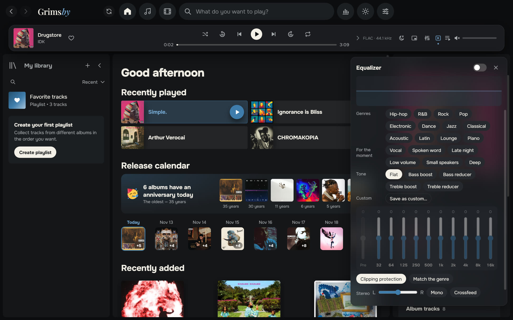

### 📻 Playlists that make themselves

- **Smart playlists**, including **"Radio: my mix"** — your most-played tracks mixed with similar ones by genre and year — and **artist radio**, a mix around one artist or genre.
- **Your own order** for playlists and folders in the side panel, kept even if you switch sorting and come back.
- Sort Favorite tracks and playlists by number, artist, title, album or length — from a menu or by clicking column headers.
- Custom covers and descriptions for playlists.

### 📊 Stats for people who love numbers

**Listening** for the week, month, year and all time: top artists, albums and tracks by minutes or plays, listening streaks. The numbers update live while music plays.
**Collection**: how many tracks, albums, genres, gigabytes and hours of music you have, what share is lossless — and how many albums you've **never played**.
**Album stats**: open any album to see how often you play it, how much of it you actually hear and which tracks you skip. Flip back through past weeks, months and years with the arrows.

Hide an artist or album from the tops right in the stats and bring it back from **Hidden**. **How long to listen** shows the whole library, what has already played, what hasn’t, and how many days it takes to hear everything at 1, 2 or 4 hours a day.

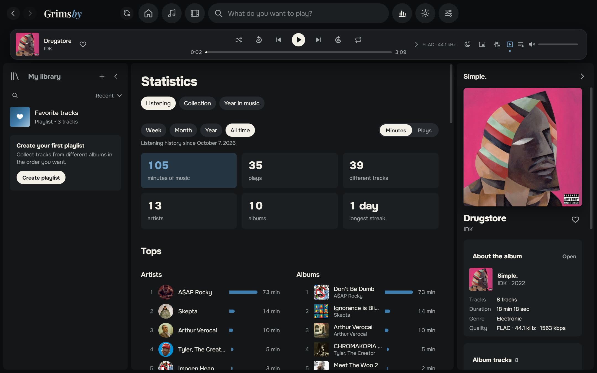

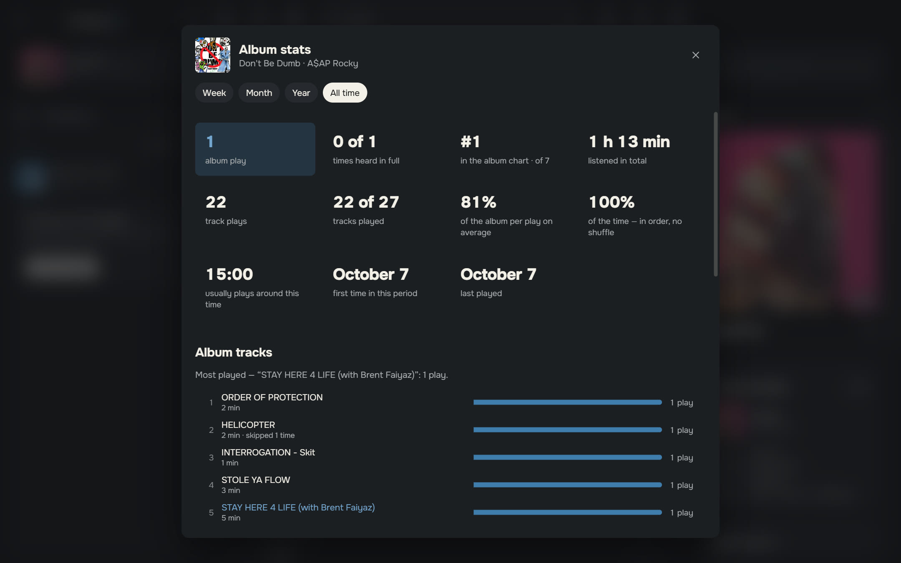

### 🎁 Your year in music

From December 1 to January 15, Grimsby gives you a yearly recap: artist of the year, album of the year, favorite tracks, records, discoveries and your listener type
("Devoted fan", "Explorer", "Night owl", "Marathoner"…). Every card can be saved as an image for stories — in the dark or the light theme.

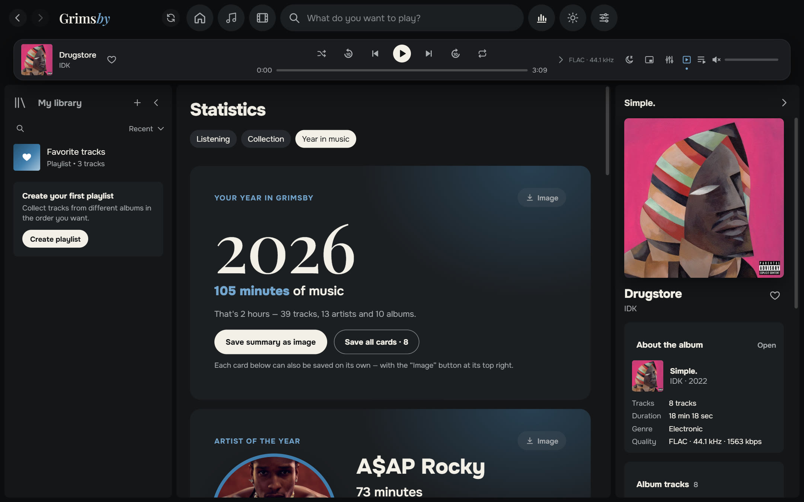

### 🎨 Dark and light themes, colors of the cover

Grimsby's signature blue, graphite and "paper". Pick a theme or follow Windows. An album or playlist page can take on the colors of its cover — from a soft glow to a full fill — with a palette button right on the page.

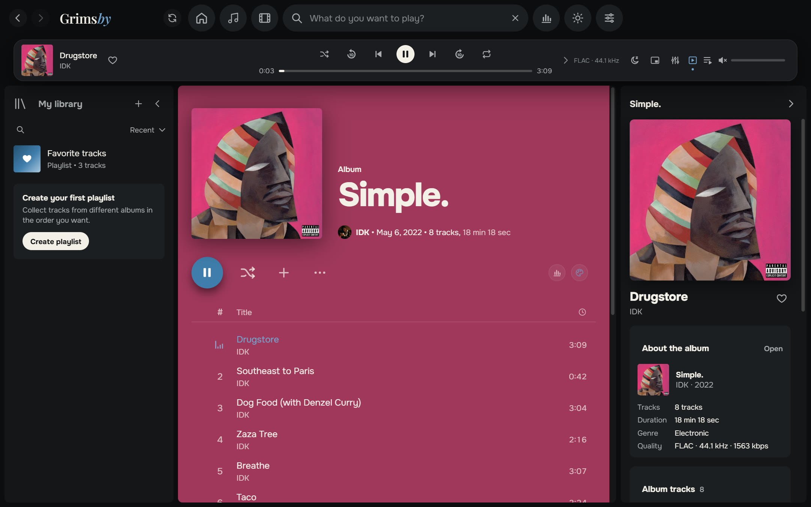

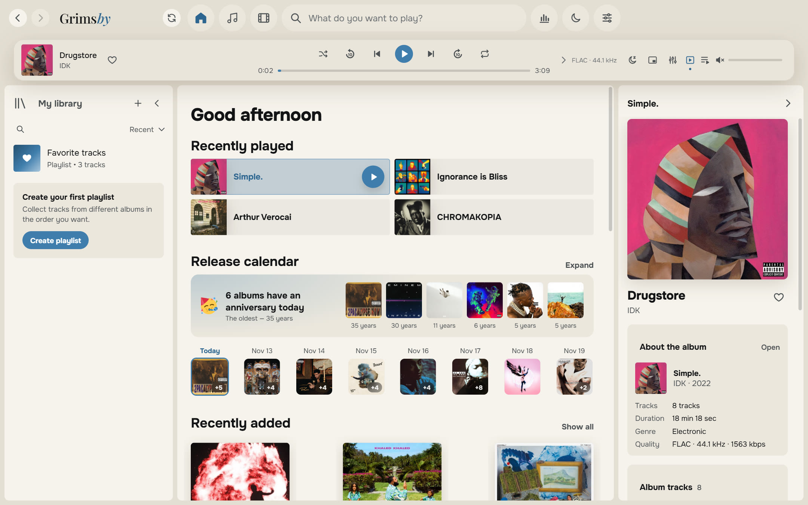

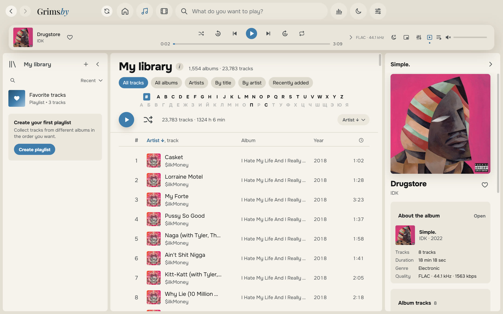

### 🖼 Your own look

Pick the app color — it tints buttons, selected items, links and progress bars — and the window background: a color, a gradient, your own photo or a silent video. Dimming, background blur and panel density are adjustable, and the video pauses by itself when the window is minimized or **For older PCs** mode is on. Settings are split into sections with a search at the top.

### 🪟 Feels at home in Windows

- a tray icon with a playback menu;
- previous / pause / next buttons in the taskbar thumbnail and media key support;
- an always-on-top mini player;
- keyboard shortcuts for everything;
- the window reopens exactly the way you left it.

### 📅 Release calendar (experimental)

Turn it on in Settings, and Home shows which of your albums turn a year older today — “4 years”, “22 years” — plus a full month calendar with covers on each day. Release dates come from your tags; if they’re missing, Grimsby can look them up online and, if you like, write them into the files.

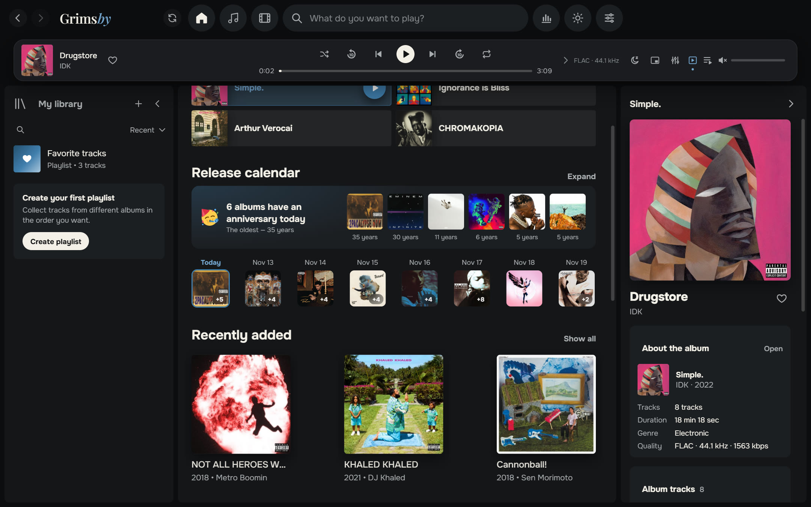

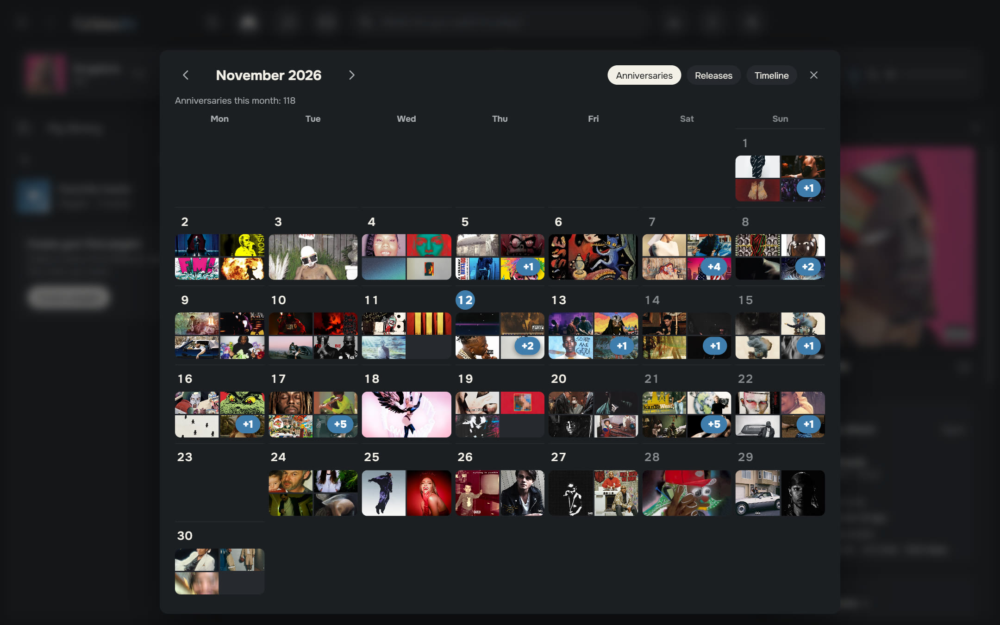

### 🌈 Shimmer, a compact player bar and a new equalizer

The new **Shimmer** style turns an album page into the slowly flowing colors of its cover. The player bar can be **Compact** — floating above the content with rounded corners and adjustable transparency — at the bottom or the top. The equalizer now opens as a glass panel right by its button: changes apply instantly, and there are more presets.

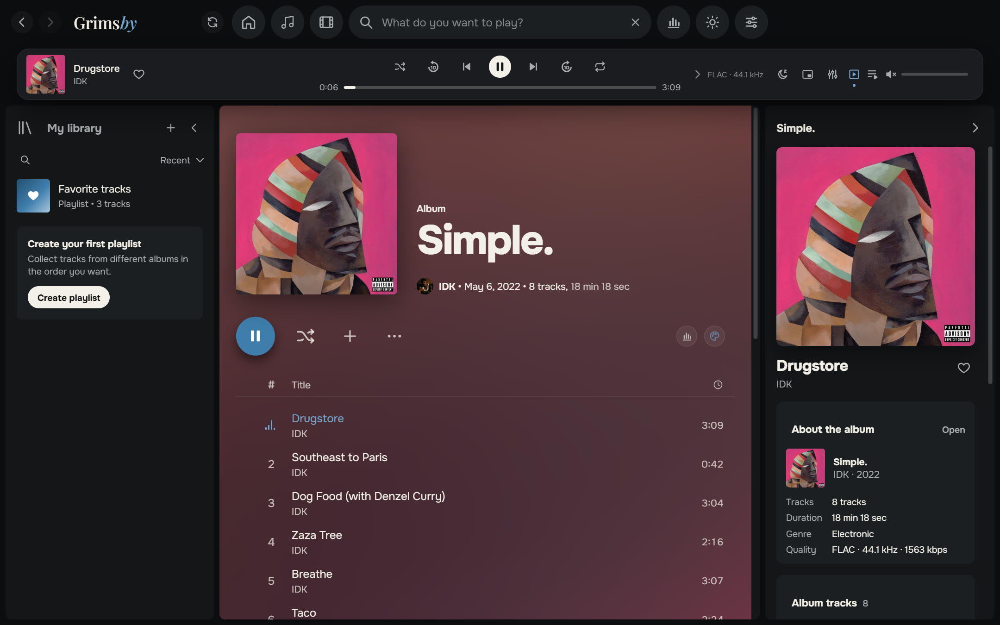

### 🗂 Sorting and Share

One album order for every year in Library and Videos, with exceptions for any year — its own order and direction. The articles The, A and An are ignored when sorting: The Weeknd sits under W. **Share** packs an album (or all of an artist’s albums) into one ZIP — audio, cover and, if you like, music videos; the **Smaller** option re-encodes tracks to MP3 320 or AAC 256, and the archive size is shown in advance.

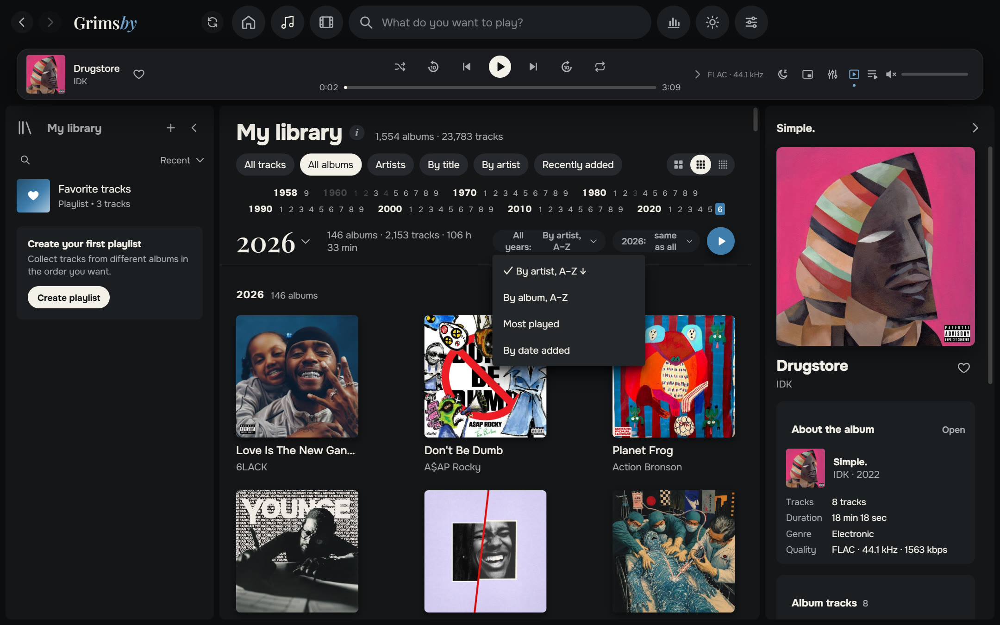

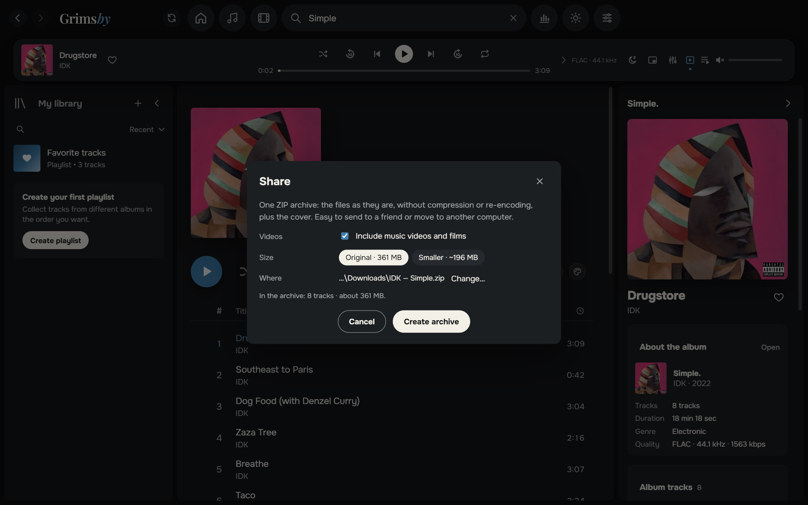

### 🧩 Grimsby apps, right in the player

Settings → About has **Feedback** (Telegram, email, GitHub) and **Grimsby apps**: Converter, Tagger, Prompter, Helper, Studio and Notes with descriptions and screenshots. Download and install in one click.

### 🛠 And more

- **Interface in 9 languages** — follows your Windows language by default.
- **Backup** of likes, playlists and history into a single file.
- **Built-in guide "How to prepare files"** in plain language.
- **Updates your way**: notify only, install automatically, or don't check at all.

---

## Download and install

1. Open the **[latest release](https://github.com/maksimkhatskevich/grimsby-releases/releases/latest)** page and download `Grimsby-Player-Setup-X.Y.Z.exe`.
2. Run the installer. Windows may show a blue "Windows protected your PC" window — that's a normal warning for apps without a paid code-signing certificate. Click **More info → Run anyway**.
   The installer has been checked on VirusTotal: [0 of 67 antivirus engines flag it](https://www.virustotal.com/gui/file/71d859507b669356dfe6d90c2416438eb28aeb83389cb11c2a2ee5040d427799) (version 1.10.1).
3. On first launch, pick your music folder (and, if you like, your videos folder). Grimsby takes care of the rest.

**Requirements:** Windows 10 or 11 (64-bit). Internet is only needed for updates and optional artist photos.

### Updates

Grimsby checks for new versions itself and shows what's changed. Your likes, playlists, history and settings are kept across updates.
The full changelog is on the [Releases](https://github.com/maksimkhatskevich/grimsby-releases/releases) page and in the app: Settings → About.

---

## How to organize your files

Grimsby doesn't make you reorganize your collection: it reads tags and understands the most common ways people store music. But it does love order:

```
D:\Music\
├── albums\
│   └── Tyler, The Creator\
│       └── CHROMAKOPIA\
│           ├── 01 - St. Chroma.flac          ← tags: artist, album, year, embedded cover
│           ├── ...
│           └── (2024) Tyler, The Creator — Noid.mp4   ← a music video of this album
└── clips\
    ├── 2024\
    │   └── Kendrick Lamar — Not Like Us.mp4  ← a music video; the year comes from the folder
    └── concerts\
        └── Tiny Desk Concert\
            └── Doechii — Tiny Desk.mp4       ← a concert in a series
```

There's a detailed guide in the app: Settings → How to prepare files.

---

## Privacy

Grimsby runs **entirely on your computer**. No accounts, no ads, no analytics. Your listening history never leaves your PC.
The app only goes online for updates and — unless you turn it off — for artist photos.

---

## Grimsby apps

<table>
  <tr>
    <td align="center" width="25%"><br><b>Grimsby Player</b><br></td>
    <td align="center" width="25%"><a href="https://github.com/maksimkhatskevich/grimsby-converter"><br><b>Grimsby Converter</b></a><br><sub>Video, audio, photos and documents — converted offline</sub></td>
    <td align="center" width="25%"><a href="https://github.com/maksimkhatskevich/grimsby-tagger"><br><b>Grimsby Tagger</b></a><br><sub>Batch tag editor: albums, covers, file names</sub></td>
    <td align="center" width="25%"><a href="https://github.com/maksimkhatskevich/grimsby-prompter"><br><b>Grimsby Prompter</b></a><br><sub>A simple teleprompter that follows your voice</sub></td>
  </tr>
  <tr>
    <td align="center" width="25%"><a href="https://github.com/maksimkhatskevich/grimsby-helper"><br><b>Grimsby Helper</b></a><br><sub>PC health at a glance: processes, temperatures, cleanup</sub></td>
    <td align="center" width="25%"><a href="https://github.com/maksimkhatskevich/grimsby-studio"><br><b>Grimsby Studio</b></a><br><sub>Video editor with animated music inserts</sub></td>
    <td align="center" width="25%"><a href="https://github.com/maksimkhatskevich/grimsby-notes"><br><b>Grimsby Notes</b></a><br><sub>Tasks, projects, notes and calendar in one window</sub></td>
  </tr>
</table>

---

## Feedback

Found a bug, have an idea or just want to say thanks? Get in touch:

- ✉️ email: **[grimsbyy@gmail.com](mailto:grimsbyy@gmail.com)**
- 🐞 bugs and ideas: [Issues](https://github.com/maksimkhatskevich/grimsby-releases/issues)
- 📣 Telegram: [@itsgrimsby](https://t.me/itsgrimsby) (in Russian)

When reporting a bug, please include your Grimsby version (Settings → About), what you were doing and, if possible, a screenshot.

---

## Licenses

Grimsby uses open-source components, including Electron, React and FFmpeg (GPL v3). The full list with license texts and links to source code is in the app: Settings → About → Open the license list.
Album covers in the screenshots belong to their rights holders and are shown as an example of a personal library.

<p align="center"><sub>Made with love for albums · © 2026 Grimsby</sub></p>
