<p align="center">
  <a href="README.md">English</a> ·
  <a href="README.ru.md">Русский</a> ·
  <a href="README.es.md">Español</a> ·
  <b>Português</b> ·
  <a href="README.de.md">Deutsch</a> ·
  <a href="README.fr.md">Français</a> ·
  <a href="README.zh.md">中文</a> ·
  <a href="README.ja.md">日本語</a> ·
  <a href="README.ko.md">한국어</a>
</p>

<p align="center">
  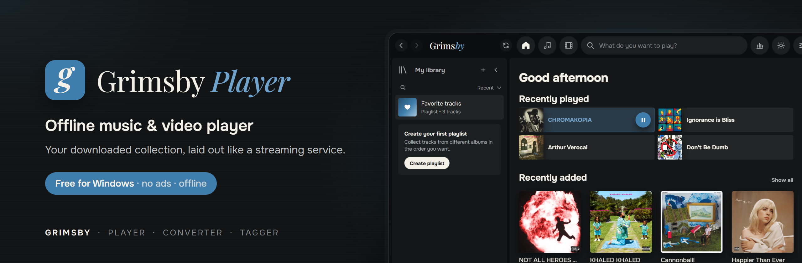
</p>

<p align="center">
  <b>O álbum inteiro. E tudo ao redor dele.</b><br>
  Clipes, filmes de álbum e shows ao lado de cada álbum — tudo da sua própria biblioteca.
</p>

<p align="center">
  <a href="https://github.com/maksimkhatskevich/grimsby-releases/releases/latest"></a>
  
  
  <a href="https://www.virustotal.com/gui/file/06b8aad3387ab36913b5d432cbcccdad2edeb9f032db192f3d095517357a6a2a"></a>
  <a href="https://github.com/maksimkhatskevich/grimsby-releases/releases"></a>
</p>

<p align="center">
  <a href="https://github.com/maksimkhatskevich/grimsby-releases/releases/latest"><b>⬇ Baixar para Windows</b></a>
</p>

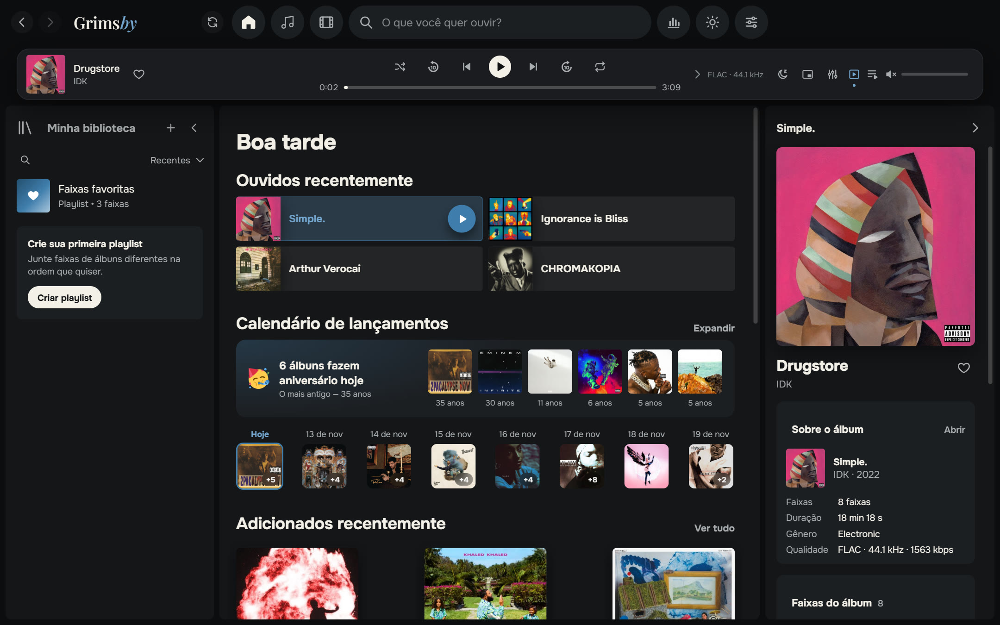

---

## Álbuns, do jeito que os artistas criaram

Para o Grimsby, um álbum é uma obra inteira, não um monte de faixas. Um vídeo na pasta de um álbum vira o clipe dele; filmes de álbum e shows ficam ao lado da música.

Se você baixa álbuns em FLAC, coleciona discografias e guarda clipes e shows, conhece o problema.
Os serviços de streaming são bonitos, mas a sua música não está lá: lançamentos raros, rips de qualidade, vídeos que sumiram da internet.
Os players clássicos lidam bem com seus arquivos — mas a interface parece de 2008.

**O Grimsby junta os dois mundos.** Aponte a sua pasta de música e, em um minuto, sua coleção vira uma biblioteca linda:
álbuns por ano, páginas de artistas com fotos, clipes ao lado dos álbuns, estatísticas e uma retrospectiva do ano.
Sem contas, sem assinaturas, sem anúncios e sem internet.

| | Streaming | Player clássico | **Grimsby** |
|---|:---:|:---:|:---:|
| Seus próprios arquivos (FLAC, lançamentos raros) | ✕ | ✓ | **✓** |
| Interface moderna e bonita | ✓ | ✕ | **✓** |
| Clipes, shows e filmes ao lado dos álbuns | em parte | ✕ | **✓** |
| Estatísticas e retrospectiva do ano | ✓ | ✕ | **✓** |
| Conversor, busca de duplicatas, editor de tags | ✕ | em parte | **✓** |
| Funciona offline, sem assinatura | ✕ | ✓ | **✓** |
| Não envia nada sobre você para lugar nenhum | ✕ | ✓ | **✓** |

**Não curte álbuns?** Mude a biblioteca para **Só faixas** nas Configurações — o Grimsby vira um player simples de faixas, sem páginas de álbum.

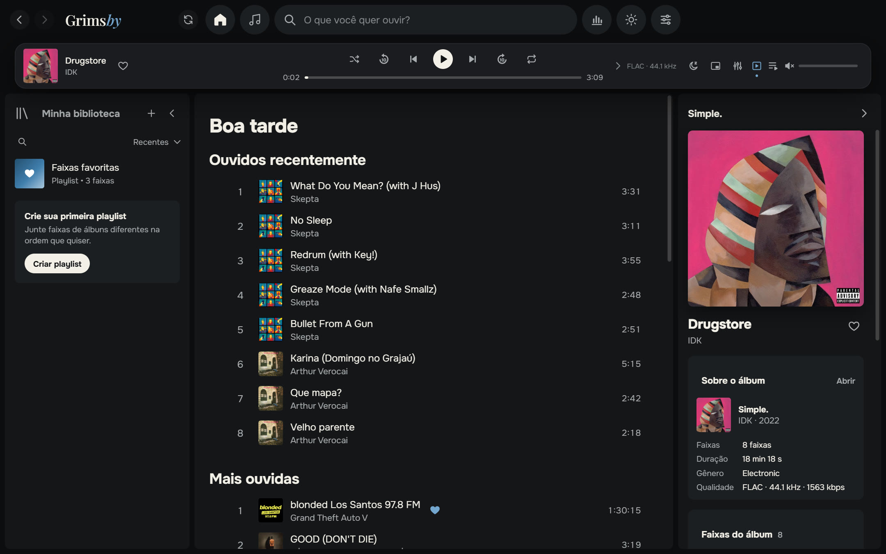

---

## Recursos

### 💿 Os álbuns em primeiro lugar

O Grimsby foi feito para ouvir álbuns inteiros. Toda a coleção é organizada por ano de lançamento: uma faixa de anos no topo,
o cabeçalho do ano atual fica fixo no alto da página e, ao clicar nele, abre um calendário para pular rapidamente.
Há também as abas «Todas as faixas» (ordenáveis por coluna), «Artistas», «Por título», «Por artista» e «Adicionados recentemente», além de uma faixa alfabética.

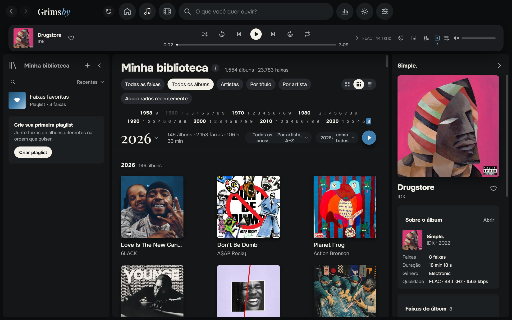

- **Instantâneo mesmo com bibliotecas enormes.** Testado com 23.783 faixas e 1.554 álbuns (286 GB): rolagem suave e busca imediata.
- **Escaneia só quando você quiser:** a cada abertura, uma vez por dia ou manualmente. Arquivos já conhecidos não são lidos de novo.
- **MP3, FLAC, ALAC, AAC/M4A, OGG, Opus e WAV.** O Grimsby converte sozinho o Apple Lossless, que os motores de navegador não tocam.
- **Álbuns com vários discos** divididos em «Disco 1», «Disco 2»… com numeração dentro de cada disco.
- **Participações** são encontradas nos títulos — `(feat. …)`, `(ft. …)`, `(with …)` — e aparecem também nas páginas dos artistas convidados.
- **Tamanho das capas**: grandes, normais ou pequenas, separadamente para música e vídeos.

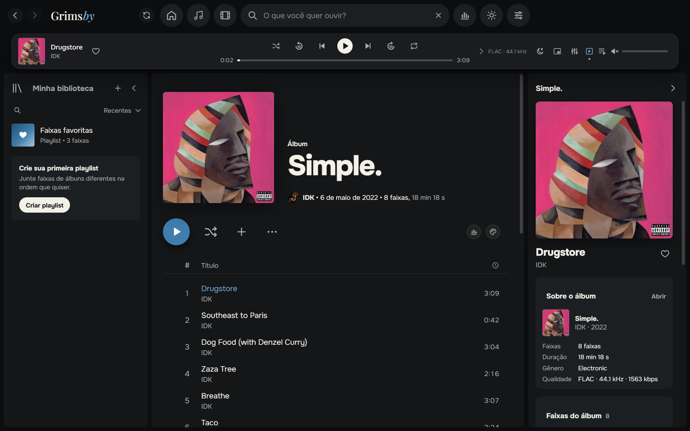

### 🎤 A história inteira de um artista em uma página

Álbuns, singles, clipes, filmes, shows e participações em uma só página. O Grimsby baixa as fotos dos artistas uma única vez — depois tudo funciona offline.
Ali mesmo estão a rádio do artista e «Assistir a todos os vídeos».

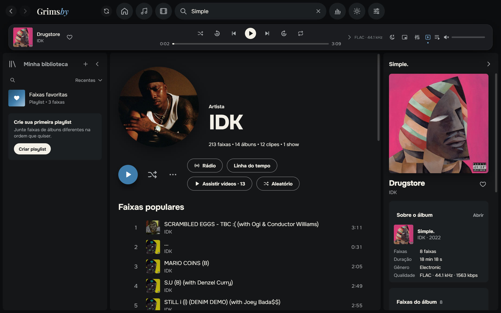

### 📈 Linha do tempo dos álbuns

Todos os álbuns de um artista numa linha do tempo com marcas por ano: quanto tempo passou entre os lançamentos, a maior pausa e quantos dias se passaram desde o último álbum. Clique em dois álbuns quaisquer para ver o tempo entre eles. Abre pelo botão **Linha do tempo** na página do artista ou pelo calendário de lançamentos completo.

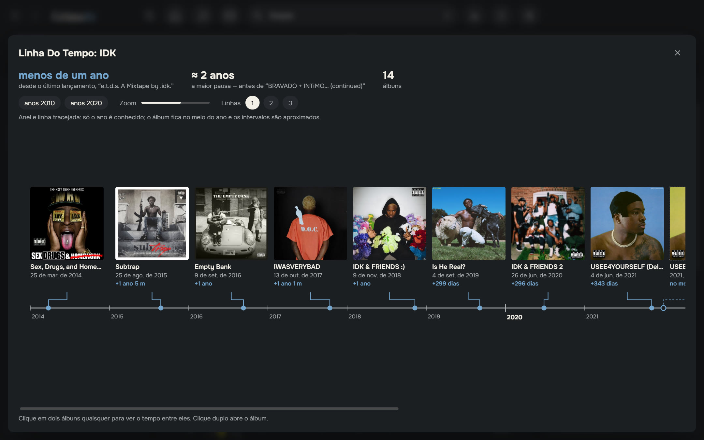

### 🔎 Busca por gênero e letras

A busca encontra não só títulos e artistas, mas também gêneros e versos das letras — das tags e dos arquivos .lrc ao lado da faixa. Os resultados mostram onde está a correspondência. Maiúsculas não importam, e se um erro de digitação não achar nada, o Grimsby mostra o mais parecido. Os gêneros agora contam separadamente: “Pop, Hip-Hop” são dois gêneros nas estatísticas, nas páginas de gênero e no equalizador.

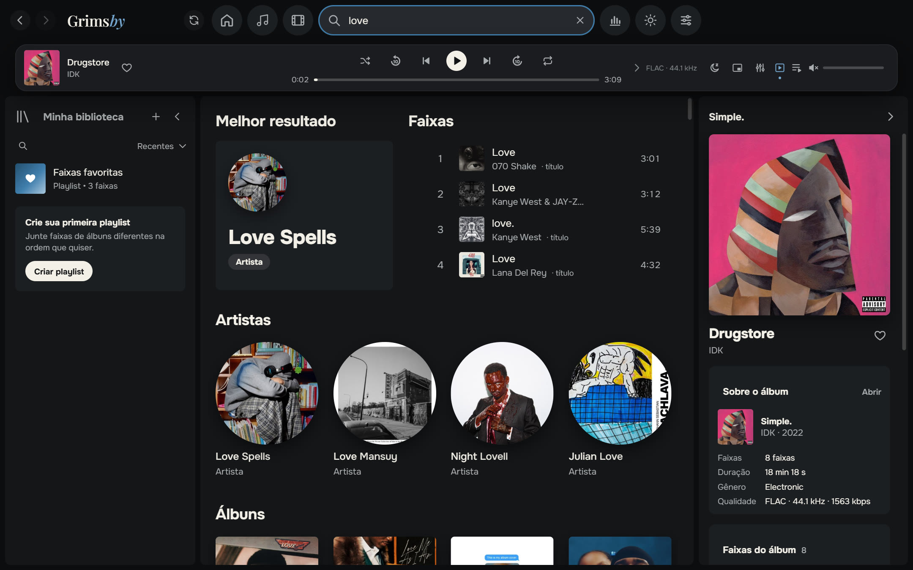

### 🎬 Clipes, shows e filmes de álbuns

Algo que nenhum streaming tem. O Grimsby organiza sua pasta de vídeos sozinho:

- vídeos com nome `Artista — Título` são agrupados por artista e ano;
- um vídeo dentro da pasta de um álbum vira clipe **daquele álbum**;
- arquivos marcados com `(Film)` viram **filmes do álbum**, e o álbum e o filme recomendam um ao outro;
- a pasta `concerts` vira uma seção de shows com séries (por exemplo, *Tiny Desk Concert*).

Os vídeos tocam dentro do app. Você pode encolher o vídeo para o canto do player e continuar navegando.
Se o arquivo usar um codec raro (por exemplo, AV1 em 4K), o Grimsby prepara uma cópia compatível sozinho.
Se a faixa tem clipe, o player mostra o botão **Ver o clipe**; no clipe, **Ouvir a faixa** volta para a música no mesmo ponto.

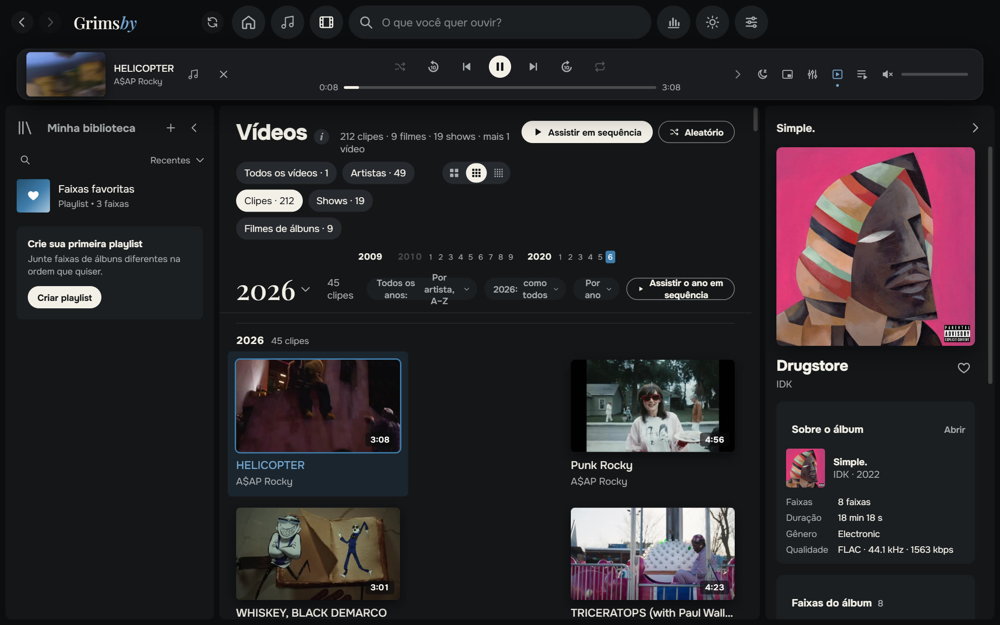

Não assiste a clipes? Desligue a seção inteira com um único botão nas configurações.

### 🧰 Biblioteca em ordem

- **Conversor de arquivos**: MP3, AAC (M4A), Opus, OGG, FLAC, ALAC e WAV. Tags e capas são mantidas. Salve cópias em outra pasta ou substitua os originais: os arquivos antigos vão para a Lixeira, e suas curtidas e playlists passam para os novos. Escolha as faixas com caixas de seleção.
- **Busca de duplicatas**: a mesma faixa em arquivos diferentes e cópias de pastas de álbuns, com pasta, formato e bitrate de cada cópia. Não é duplicata? Clique em «Tudo certo» e o Grimsby lembra.
- **Saúde da biblioteca** com carinha de humor 😊 😐 😟: álbuns sem capa, ano ou gênero, faixas sem número, arquivos ilegíveis — e como corrigir.
- **Álbuns sem data de lançamento** — uma lista de álbuns sem data completa: busque as datas na internet para todos os selecionados de uma vez ou digite à mão, guarde só no Grimsby ou grave nas tags.
- **Editar detalhes**: tags e capa de um álbum inteiro de uma vez, inclusive a divisão em discos. O Grimsby faz backup dos arquivos antes de alterar.

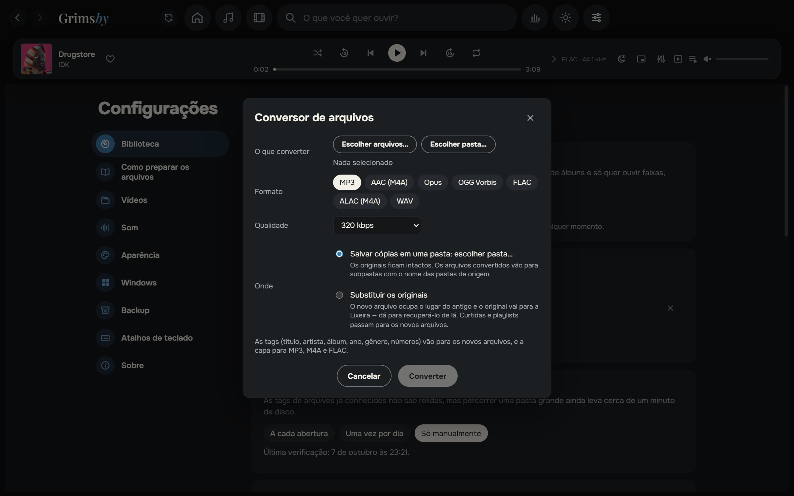

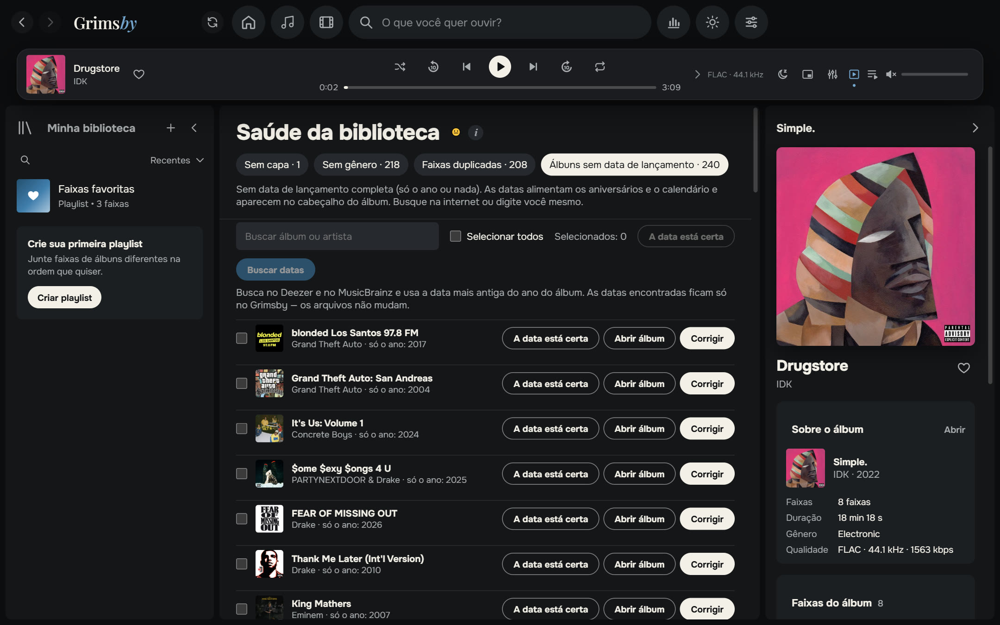

### 🔊 Som de player de verdade

- **Reprodução sem pausas (gapless)** — álbuns conceituais tocam sem cortes entre as faixas.
- **Crossfade de 2 a 12 segundos**, desligado automaticamente dentro de um mesmo álbum.
- **Nivelamento de volume (ReplayGain / LUFS)**: inteligente, por faixa ou por álbum.
- **Equalizador de 10 bandas** com predefinições: Hip-hop, R&B, Mais graves, Vocal, Volume baixo e outras.
- **Timer para dormir, mini player sempre visível, «Tocar a seguir» e fila com arrastar e soltar.**
- **Faixas longas e mixes** continuam de onde você parou.

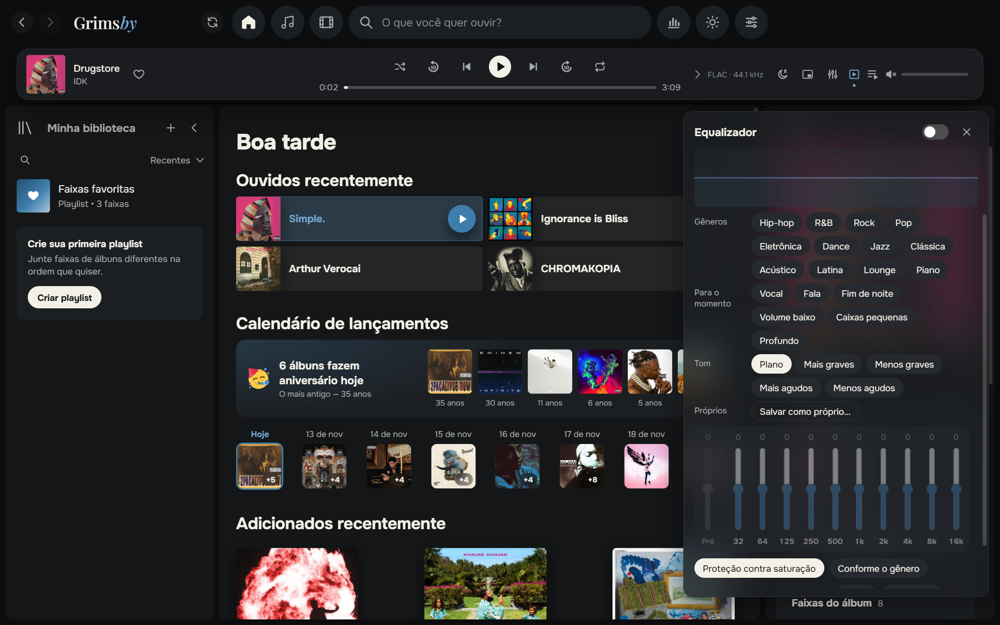

### 📻 Playlists que se montam sozinhas

- **Playlists inteligentes**, incluindo **«Rádio: meu mix»** — o que você mais ouve misturado com músicas parecidas por gênero e ano — e **«Rádio do artista»**, um mix em torno de um artista ou gênero.
- **Sua própria ordem** de playlists e pastas no painel lateral, mantida mesmo se você trocar a ordenação e voltar.
- Ordene «Faixas favoritas» e playlists por número, artista, título, álbum ou duração — por um menu ou clicando nos cabeçalhos das colunas.
- Capas e descrições próprias para as playlists.

### 📊 Estatísticas para quem ama números

**Escutas** da semana, do mês, do ano e de sempre: top de artistas, álbuns e faixas por minutos ou reproduções, sequências de dias com música. Os números se atualizam ao vivo enquanto a música toca.
**Coleção**: quantas faixas, álbuns, gêneros, gigabytes e horas de música você tem, quanto é lossless — e quantos álbuns você **nunca ouviu**.
**Estatísticas do álbum**: abra qualquer álbum e veja com que frequência você o ouve, quanto dele realmente escuta e quais faixas pula. Navegue por semanas, meses e anos anteriores com as setas.

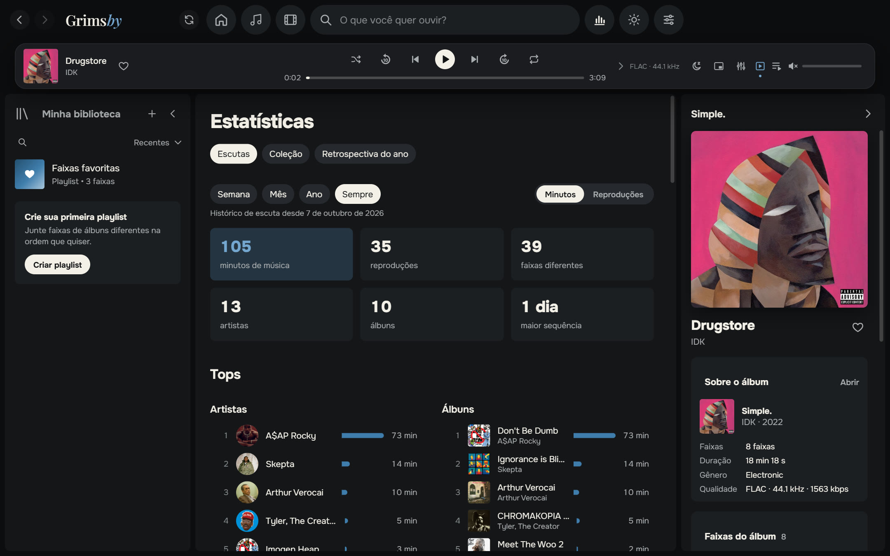

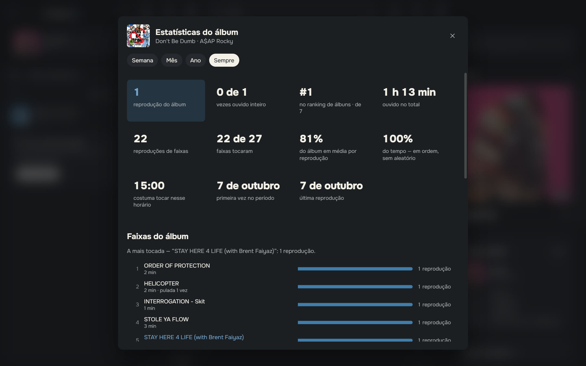

### 🎁 Retrospectiva do ano

De 1º de dezembro a 15 de janeiro, o Grimsby te dá uma retrospectiva do ano: artista do ano, álbum do ano, faixas favoritas, recordes, descobertas e o seu tipo de ouvinte
(«Fã fiel», «Explorador», «Coruja», «Maratonista»…). Cada card pode ser salvo como imagem para os stories, no tema escuro ou claro.

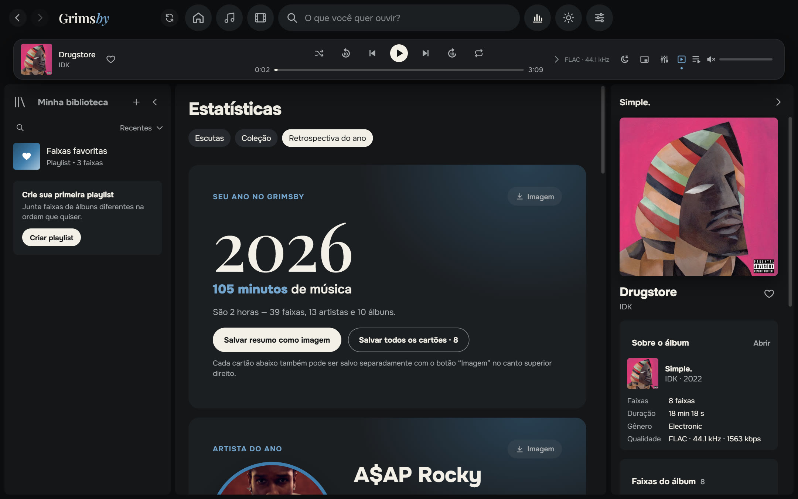

### 🎨 Temas escuro e claro, cores da capa

O azul característico do Grimsby, grafite e «papel». Escolha um tema ou siga o Windows. A página de um álbum ou playlist pode ganhar as cores da capa — de um brilho suave a um preenchimento total — com um botão de paleta na própria página.

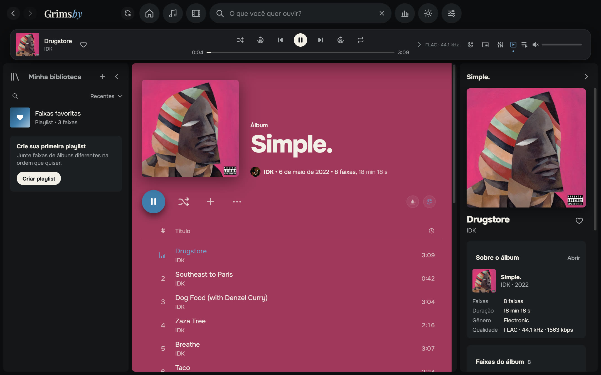

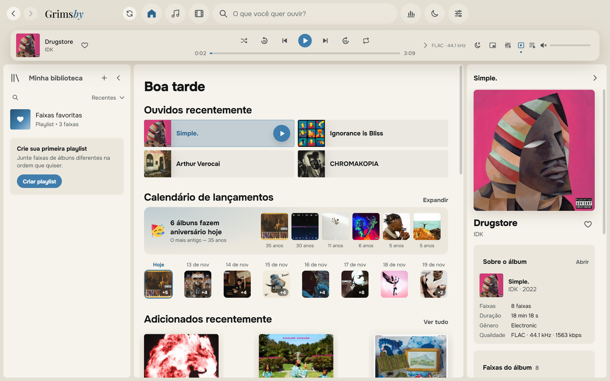

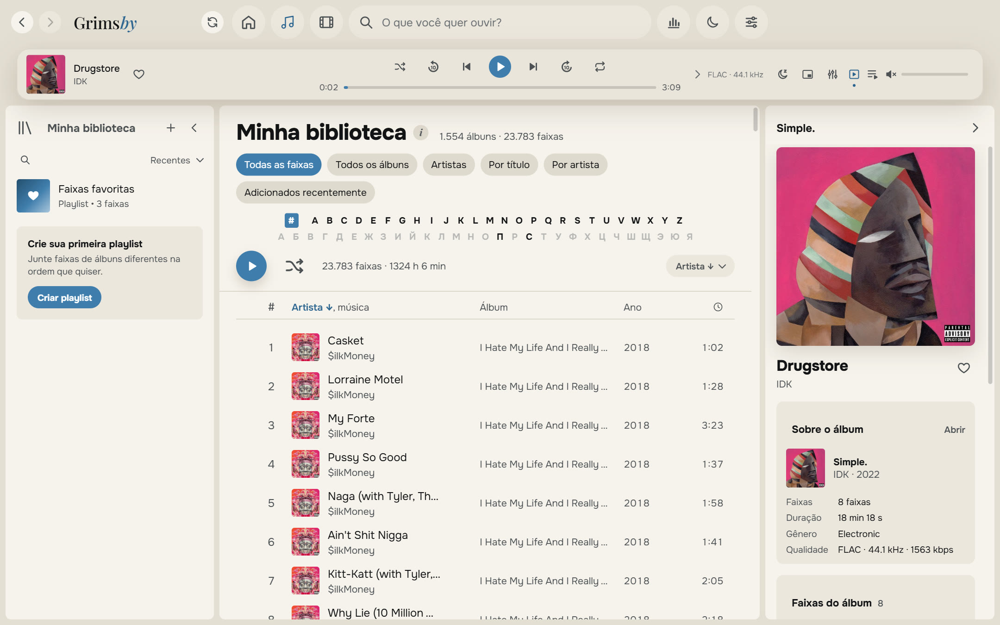

### 🪟 Em casa no Windows

- ícone na bandeja do sistema com menu de reprodução;
- botões anterior / pausa / próxima na miniatura da barra de tarefas e teclas de mídia;
- mini player sempre visível;
- atalhos de teclado para tudo;
- a janela abre exatamente como você a fechou.

### 📅 Calendário de lançamentos (experimental)

Ative nas Configurações e o Início mostra quais álbuns fazem aniversário hoje — “4 anos”, “22 anos” — e um calendário do mês com capas em cada dia. As datas vêm das suas tags; se faltarem, o Grimsby pode buscá-las na internet e, se quiser, gravá-las nos arquivos.

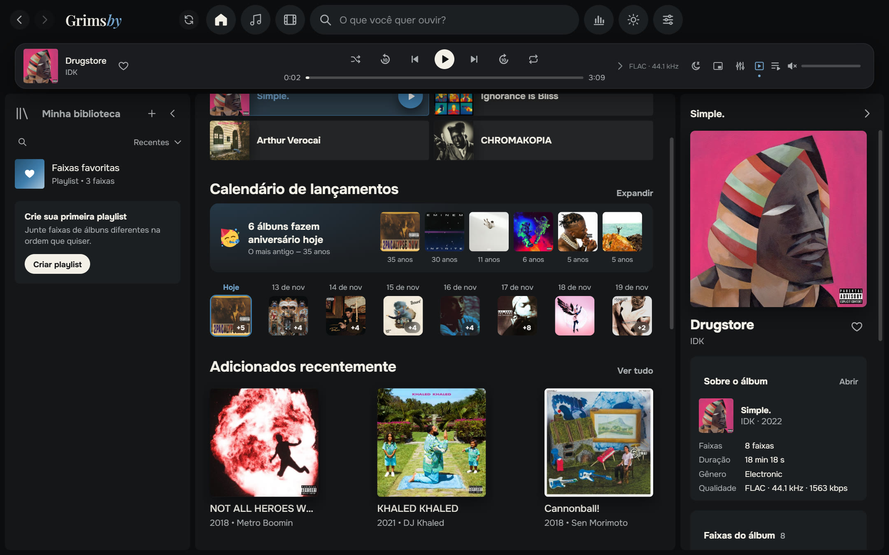

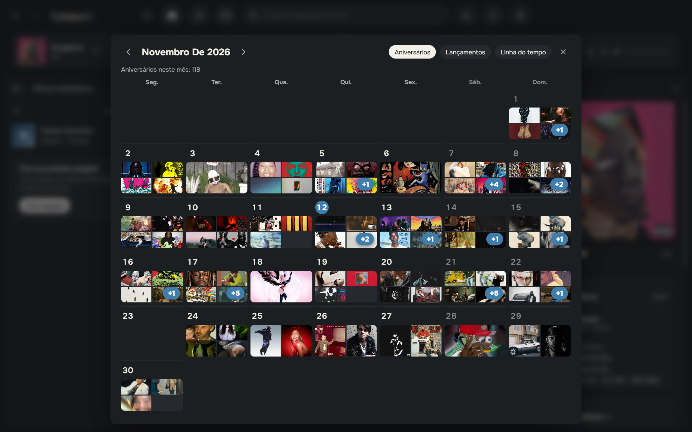

### 🌈 Brilho, barra compacta e um novo equalizador

O novo estilo **Brilho** transforma a página do álbum nas cores da capa fluindo devagar. A barra do player pode ser **Compacta** — flutuando sobre o conteúdo, com cantos arredondados e transparência ajustável — embaixo ou em cima. O equalizador abre como um painel de vidro ao lado do botão: as mudanças valem na hora, e há mais predefinições.

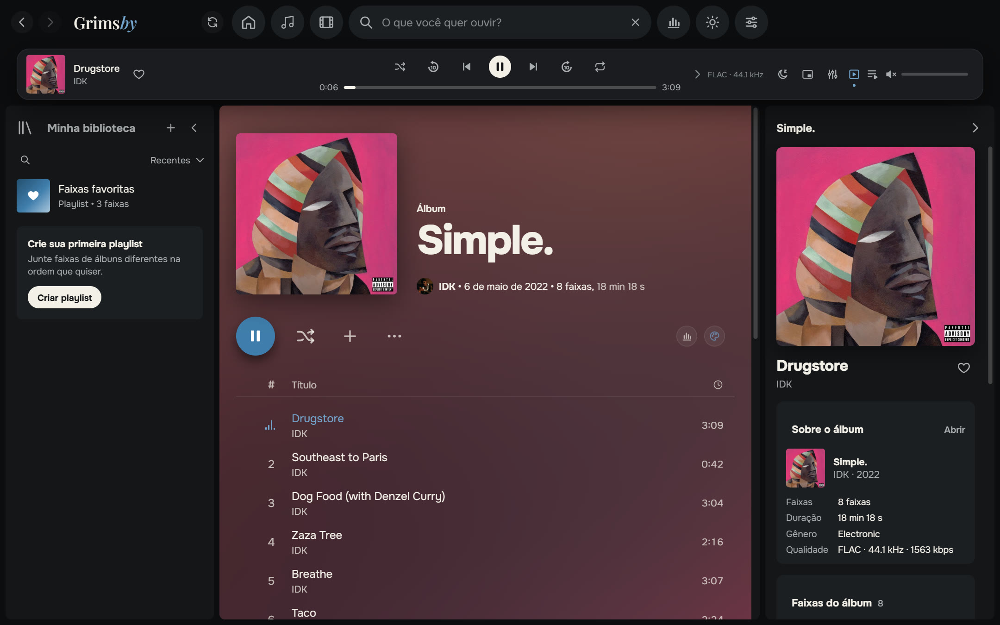

### 🗂 Ordenação e Compartilhar

Uma ordem de álbuns para todos os anos em Biblioteca e Vídeos, com exceções para qualquer ano — com ordem e direção próprias. Os artigos The, A e An são ignorados na ordenação: The Weeknd fica no W. **Compartilhar** junta um álbum (ou todos os álbuns de um artista) num ZIP — áudio, capa e, se quiser, clipes; a opção **Menor** recodifica as faixas em MP3 320 ou AAC 256, e o tamanho do arquivo aparece antes.

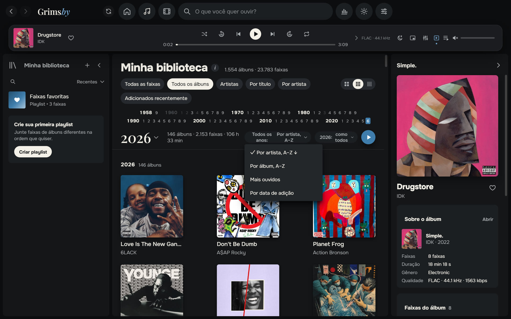

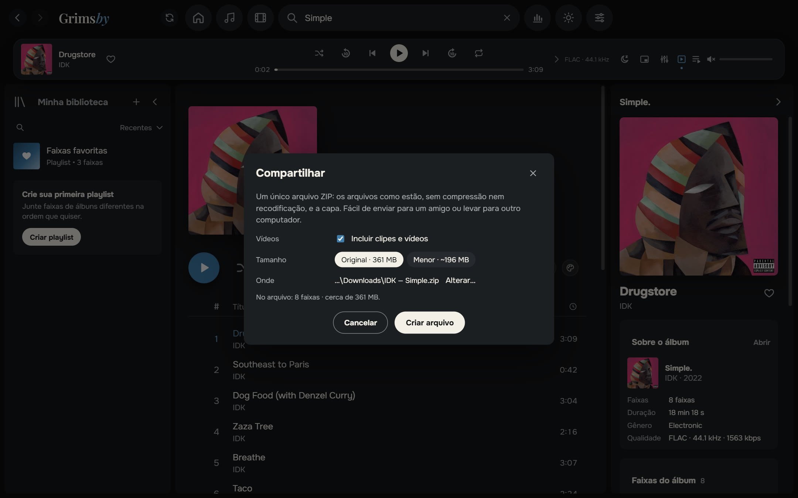

### 🧩 Os apps Grimsby dentro do player

Em Configurações → Sobre ficam **Feedback** (Telegram, e-mail, GitHub) e **Apps Grimsby**: Converter, Tagger, Prompter e Helper com descrição e capturas de tela. Baixe e instale com um clique.

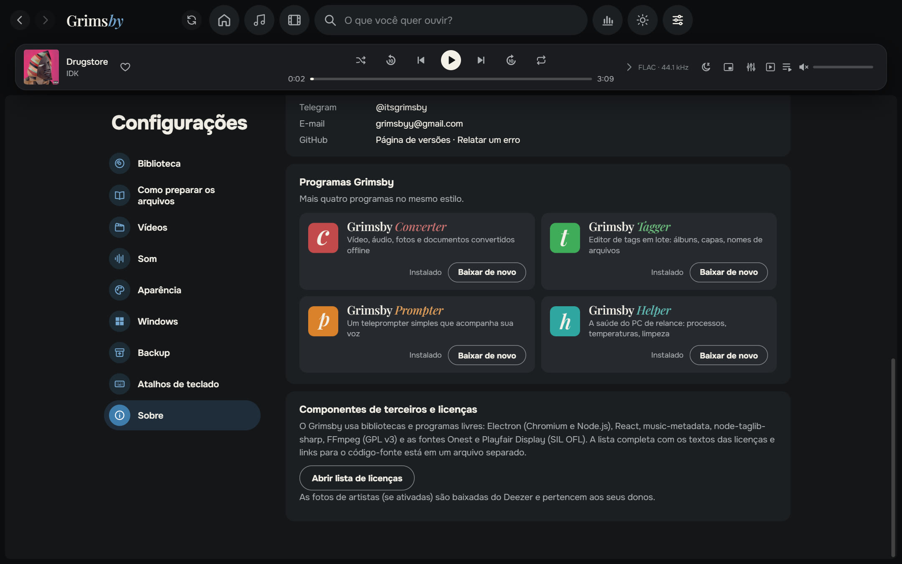

### 🛠 E mais

- **Interface em 9 idiomas** — por padrão, no idioma do seu Windows.
- **Backup** de curtidas, playlists e histórico em um único arquivo.
- **Guia integrado «Como preparar os arquivos»** em linguagem simples.
- **Atualizações do seu jeito**: «Só avisar», «Automaticamente» ou «Não verificar».

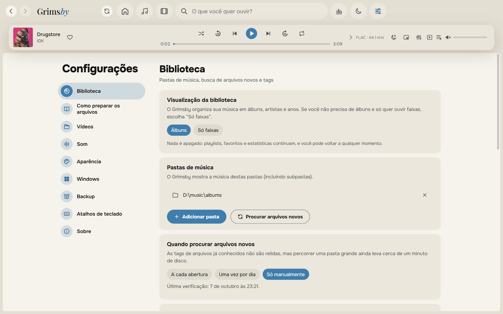

---

## Baixar e instalar

1. Abra a página da **[versão mais recente](https://github.com/maksimkhatskevich/grimsby-releases/releases/latest)** e baixe `Grimsby-Player-Setup-X.Y.Z.exe`.
2. Execute o instalador. O Windows pode mostrar a janela azul «O Windows protegeu o computador» — é um aviso normal para programas sem assinatura digital paga. Clique em **Mais informações → Executar assim mesmo**.
   O instalador foi verificado no VirusTotal: [nenhum dos 67 antivírus encontrou nada](https://www.virustotal.com/gui/file/06b8aad3387ab36913b5d432cbcccdad2edeb9f032db192f3d095517357a6a2a) (versão 1.9.0).
3. Na primeira abertura, escolha sua pasta de música (e, se quiser, a de vídeos). O Grimsby faz o resto.

**Requisitos:** Windows 10 ou 11 (64 bits). A internet só é necessária para atualizações e fotos de artistas opcionais.

O Grimsby procura novas versões sozinho e mostra o que mudou. Suas curtidas, playlists, histórico e configurações são mantidos.

---

## Como organizar seus arquivos

O Grimsby não obriga você a reorganizar a coleção: ele lê as tags e entende as formas mais comuns de guardar música. Mas ele gosta de ordem:

```
D:\Music\
├── albums\
│   └── Tyler, The Creator\
│       └── CHROMAKOPIA\
│           ├── 01 - St. Chroma.flac          ← tags: artista, álbum, ano, capa embutida
│           └── (2024) Tyler, The Creator — Noid.mp4   ← clipe deste álbum
└── clips\
    ├── 2024\
    │   └── Kendrick Lamar — Not Like Us.mp4  ← clipe; o ano vem da pasta
    └── concerts\
        └── Tiny Desk Concert\
            └── Doechii — Tiny Desk.mp4       ← show dentro de uma série
```

Há um guia detalhado no app: «Configurações → Como preparar os arquivos».

---

## Privacidade

O Grimsby funciona **inteiramente no seu computador**. Sem contas, sem anúncios, sem analytics. Seu histórico de escuta nunca sai do seu PC.
O app só se conecta para buscar atualizações e — se você não desligar — fotos de artistas.

---

## Os apps Grimsby

<table>
  <tr>
    <td align="center" width="20%"><br><b>Grimsby Player</b><br></td>
    <td align="center" width="20%"><a href="https://github.com/maksimkhatskevich/grimsby-converter/blob/main/README.pt.md"><br><b>Grimsby Converter</b></a><br><sub>Vídeo, áudio, fotos e documentos convertidos offline</sub></td>
    <td align="center" width="20%"><a href="https://github.com/maksimkhatskevich/grimsby-tagger/blob/main/README.pt.md"><br><b>Grimsby Tagger</b></a><br><sub>Editor de tags em lote: álbuns, capas, nomes de arquivos</sub></td>
    <td align="center" width="20%"><a href="https://github.com/maksimkhatskevich/grimsby-prompter/blob/main/README.pt.md"><br><b>Grimsby Prompter</b></a><br><sub>Um teleprompter simples que acompanha sua voz</sub></td>
    <td align="center" width="20%"><a href="https://github.com/maksimkhatskevich/grimsby-helper/blob/main/README.pt.md"><br><b>Grimsby Helper</b></a><br><sub>A saúde do PC de relance: processos, temperaturas, limpeza</sub></td>
  </tr>
</table>

---

## Contato

Achou um bug, tem uma ideia ou só quer agradecer?

- ✉️ e-mail: **[grimsbyy@gmail.com](mailto:grimsbyy@gmail.com)**
- 🐞 bugs e ideias: [Issues](https://github.com/maksimkhatskevich/grimsby-releases/issues)
- 📣 Telegram: [@itsgrimsby](https://t.me/itsgrimsby) (em russo)

Ao relatar um bug, informe a versão do Grimsby («Configurações → Sobre»), o que você estava fazendo e, se possível, uma captura de tela.

---

## Licenças

O Grimsby usa componentes de código aberto, incluindo Electron, React e FFmpeg (GPL v3). A lista completa com licenças e links para o código-fonte está no app: «Configurações → Sobre».
As capas nas capturas pertencem aos detentores dos direitos e aparecem como exemplo de uma biblioteca pessoal.

<p align="center"><sub>Feito com amor pelos álbuns · © 2026 Grimsby</sub></p>
